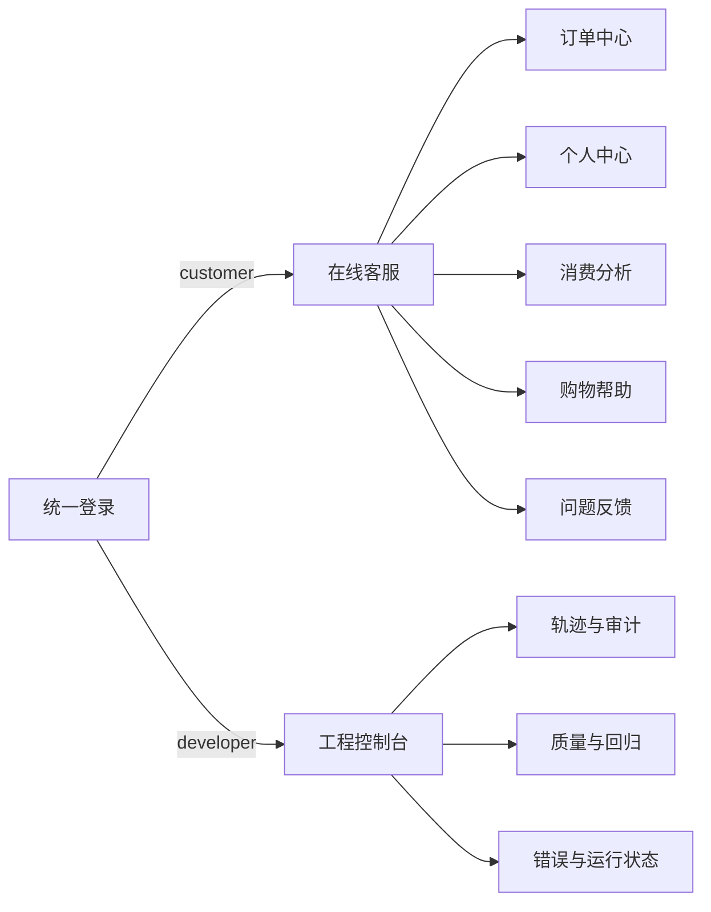
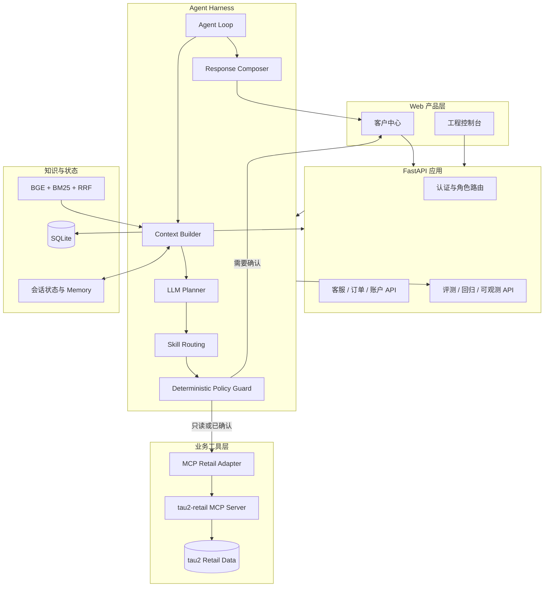
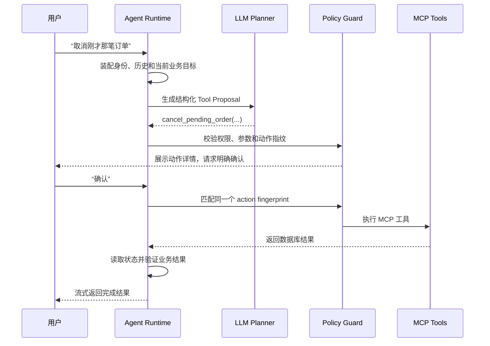

# Adaptive E-commerce Agent

> 一个可以在本地完整运行、评测和观测的电商客服 Agent：它不只生成回答，还能理解连续对话、查询真实业务数据、调用 MCP 工具、执行安全审批，并把结果沉淀为可回归的工程证据。


[快速开始](#快速开始) · [系统架构](#系统架构) · [产品功能](#产品功能) · [Agent 实战课程](docs/agent-course/README.md) · [生产运行手册](docs/operations/production-runbook.md)

---

## 为什么做这个项目

很多 Agent Demo 停在“模型会聊天、偶尔能调工具”。真实客服系统还必须解决身份隔离、多轮上下文、写操作确认、失败恢复、政策依据、业务结果验证、成本与错误观测等问题。

本项目以 [tau2-bench Retail](https://github.com/sierra-research/tau2-bench) 为业务环境，把这些问题放进同一个可运行产品：

- 普通用户通过客服中心查询订单、取消/修改订单、退换货、管理地址和查看消费分析。
- Agent 使用 LLM Planner 决策，但所有工具执行都经过确定性策略守卫。
- 高风险写操作必须由用户确认同一个 action fingerprint 后才会执行。
- 开发人员通过工程控制台查看轨迹、Token、成本、失败原因、用户反馈和回归结果。
- Policy RAG 使用 `bge-small-zh-v1.5 + BM25 + RRF`，回答可以追溯到政策依据。

## 产品功能

### 客户侧

| 页面 | 能力 |
| --- | --- |
| 在线客服 `/support/` | 流式回答、订单卡片、多轮上下文、进度提示、HITL 确认、人工接管、会话分组/置顶/重命名/逻辑删除 |
| 订单中心 `/orders/` | 查看当前用户全部订单、状态、商品与可执行售后动作 |
| 个人中心 `/account/` | 编辑个人资料，管理多个收货地址、收货人、电话和默认地址 |
| 消费分析 `/account/spending/` | 按周、月、年查看消费趋势和品类构成 |
| 购物帮助 `/help/` | 浏览政策，并通过 Hybrid RAG 检索购物与售后规则 |
| 问题反馈 `/support/feedback/` | 提交产品问题，进入工程侧反馈闭环 |

### 工程侧

| 页面 | 能力 |
| --- | --- |
| 总览 | 调用量、成功率、运行时间、Token、成本、错误与近期质量趋势 |
| 会话与轨迹 | 查看 Planner、Tool Proposal、Guard、MCP 执行和最终回复事件 |
| 回归测试 | 把 bad case 加入测试集，比较期望动作、实际动作和业务结果 |
| 错误与反馈 | 汇总前后端错误、失败类型、用户意见和处理状态 |
| RAG 质量 | 检查召回结果、融合排序和政策依据 |
| 系统运行 | 健康、就绪、工具后端、模型和持久化状态 |



## 系统架构

当前版本采用轻量、本地优先的单体部署：FastAPI 同时提供 API 和原生 Web 页面，SQLite 保存账户、会话、反馈与工程数据，Retail 工具通过独立 MCP 服务执行。



### 一次请求如何运行



## 关键设计

| 问题 | 本项目的处理方式 |
| --- | --- |
| 模型幻觉调用 | Planner 只产生结构化提案，执行权属于 Guard 和 Tool Executor |
| 越权访问 | 登录账户绑定唯一 Retail 用户，服务层再次限制数据范围 |
| 误取消/误退货 | 写操作详情 + action fingerprint + 明确确认 |
| “工具成功”但业务没变 | 执行后重新读取状态，验证业务结果而非只看 HTTP 200 |
| 多轮对话丢上下文 | 持久化消息、业务目标、已解析订单和 pending action |
| 政策回答无依据 | 稠密向量与 BM25 双路召回，RRF 融合并保留来源 |
| 线上问题难复现 | Trace、错误收集、用户反馈和 bad case 回归测试闭环 |
| Rule 与 LLM 混淆 | 产品默认使用 LLM；Rule 仅用于确定性测试和故障排查 |

## 快速开始

### 1. 环境要求

- macOS / Linux
- Conda（Python 3.12）
- Git、curl
- 一个 OpenAI-compatible 模型 API；当前示例使用阿里云百炼/DashScope

### 2. 创建环境

```bash
conda create -n ecom-agent python=3.12 -y
conda activate ecom-agent
python -m pip install --upgrade pip uv

cd benchmarks
uv sync --group dev
cd ..
```

### 3. 配置模型

```bash
cp .env.example .env
```

至少填写：

```dotenv
DASHSCOPE_API_KEY=your-key
ECOM_AGENT_PROPOSAL_GENERATOR=llm
ECOM_AGENT_PROPOSAL_LLM=dashscope/qwen3.8-max
```

不要提交 `.env`。如果曾把密钥粘贴到聊天、日志或 Git 历史中，应先在供应商控制台轮换。

### 4. 初始化演示用户并启动

```bash
./scripts/seed_demo_customers.sh
BACKEND_PORT=8020 ./scripts/run_local_product.sh
```

访问：

- 登录页：<http://127.0.0.1:8020/login/>
- 客服中心：<http://127.0.0.1:8020/support/>
- 工程控制台：<http://127.0.0.1:8020/dashboard/>
- API 文档：<http://127.0.0.1:8020/docs>

### 5. 演示账号

| 角色 | 账号 | 初始密码 | 说明 |
| --- | --- | --- | --- |
| 开发人员 | `admin@local.dev` | `Admin@123456` | 首次登录要求修改密码 |
| 普通用户 | `ivan.santos3158@example.com` | `DemoCustomer@123` | 绑定 tau2 Retail 订单数据 |

这些账号和订单均为演示数据，不是真实客户信息。公开部署前必须关闭或替换默认账号。

## 数据与依赖边界

- `benchmarks/` 基于 tau2-bench，保留上游许可证和出处。
- 演示用户通过 `scripts/seed_demo_customers.sh` 创建，并绑定 Retail 测试用户。
- 本地 SQLite、备份、模型缓存、API 密钥和运行日志不应提交 GitHub。
- 大型 benchmark 数据建议通过下载脚本或 Release 提供；GitHub 普通 Git 不适合保存超大数据集。

第三方代码、我们的修改点和完整下载地址见
[THIRD_PARTY_NOTICES.md](THIRD_PARTY_NOTICES.md)。GitHub 上传分类见
[公开发布检查清单](docs/operations/github-publication-checklist.md)。

## 验证质量

```bash
./scripts/test_backend.sh -q
./scripts/validate_local.sh
BASE_URL=http://127.0.0.1:8020 ./scripts/validate_product_stack.sh
benchmarks/.venv/bin/python scripts/evaluate_policy_rag.py
./scripts/production_acceptance.sh
```

评测不只比较文字答案，还关注 Tool sequence 与参数、HITL 门禁、确认后的业务状态变化、Token/成本/时延/停止原因，以及 bad case 是否进入回归集。

## Agent 实战课程

如果你希望理解“为什么这样设计”，从 [Agent 工程实战课程](docs/agent-course/README.md) 开始：

```text
聊天机器人 vs Agent
  → Harness 与 Loop
  → Planner 与 Skills
  → MCP Tools
  → Guard 与 HITL
  → Context 与 Memory
  → Policy RAG
  → 客服业务闭环
  → Evaluation / Reflection / Observability
  → Production
```

每课都有真实代码地图、动手实验、验证方法和常见误区，适合把该仓库作为 Agent 工程学习项目或作品集。

## 仓库结构

```text
backend/app/
├── agent/          # Harness、Planner、Loop、状态、回复质量
├── tools/          # Tool Port、MCP Adapter、统一执行器
├── policy/         # 确定性策略守卫与确认门禁
├── rag/            # Policy RAG、embedding、检索与评测
├── auth/ account/  # 登录、角色、客户身份和地址簿
├── support/ orders/# 客服会话、人工转接和订单服务
├── evaluation/     # tau2 任务、结果与质量门禁
├── regression/     # bad case 和回归运行
├── observability/  # 错误、反馈和脱敏
├── operations/     # 健康、限流、备份和运行检查
└── persistence/    # SQLite repositories 与 migrations

frontend/
├── support/        # 客服中心与会话交互
├── orders/         # 订单中心
├── account/        # 账户、地址簿与消费分析
├── help/           # 政策与帮助中心
├── dashboard/      # 开发观测控制台
├── auth/           # 登录、注册与修改密码
└── shared/         # 客户侧公共导航和样式

docs/agent-course/  # 十课 Agent 工程实战教程
scripts/            # 启动、验证、评测、备份和安全脚本
benchmarks/         # tau2-bench 运行环境与 Retail 数据
```

## 当前限制与演进方向

- 当前是本地单实例产品，SQLite 适合演示和单机使用；多实例部署可演进到 PostgreSQL。
- 前端是无构建工具的原生 HTML/CSS/JS，部署简单；大型团队协作时可迁移至 React/Vue。
- 当前主业务域是 Retail；Tool Port 与 MCP 边界允许后续增加其他业务域。
- 当前以单主 Agent + Skills 为主，没有为了展示复杂度而引入多 Agent。
- Kubernetes、分布式队列和外部可观测平台属于后续规模化选项，不是当前运行依赖。

## 文档

- [Agent 工程实战课程](docs/agent-course/README.md)
- [最终实现路线图](docs/final_implementation_roadmap.md)
- [生产运行手册](docs/operations/production-runbook.md)
- [GitHub 公开发布检查清单](docs/operations/github-publication-checklist.md)
- [第三方代码与数据声明](THIRD_PARTY_NOTICES.md)

生成额外的脱敏 GitHub 上传副本：

```bash
./scripts/build_github_release_bundle.sh
```
- [安全例外说明](docs/operations/security-waivers.md)
- [tau2 Retail 基线](docs/baseline/p0_tau2_retail_baseline.md)

## 致谢与许可

Retail benchmark、策略和测试数据来源于 [sierra-research/tau2-bench](https://github.com/sierra-research/tau2-bench)，其上游代码采用 MIT License。当前仓库尚未选择自己的开源许可证；正式发布前需要补充 `LICENSE`，并分别检查代码、数据和模型许可证是否允许目标分发方式。

本项目用于 Agent 工程学习、评测和本地产品验证。演示政策是教学语料，不构成淘宝或任何平台的正式承诺；真实业务上线前必须由法务和业务负责人审核。

