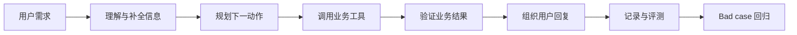
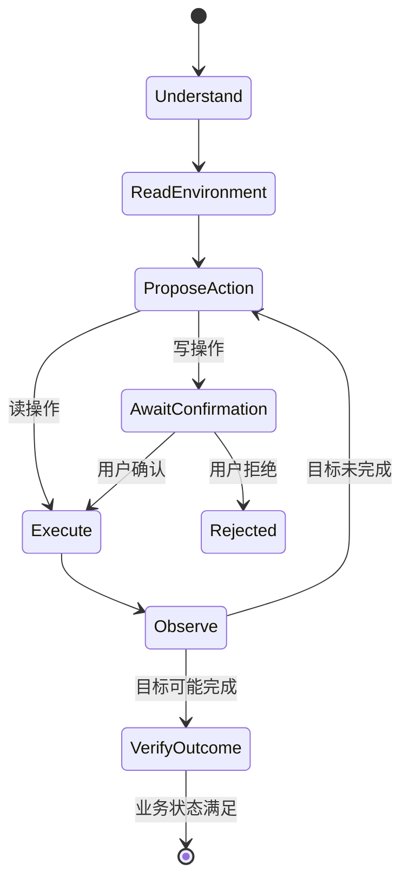

# 第 01 课：从聊天机器人到业务 Agent

## 3 分钟速记

聊天机器人主要完成“输入文本 → 输出文本”；业务 Agent 还要维护状态、选择工具、遵守权限、处理失败并验证结果。最关键的变化不是多写一个 Prompt，而是增加一个约束模型行为的执行系统。

```text
Chatbot = LLM(prompt, messages)
Agent   = Harness(LLM + State + Tools + Policy + Loop + Evaluation)
```

## 学习目标

- 区分回答质量、动作质量和业务结果质量；
- 理解为什么客服场景适合用“单主 Agent + Skills”；
- 建立本项目端到端模块地图。

## 完整闭环



如果缺少 `Verify`，工具返回成功但数据库未变化也会被误判为完成；如果缺少 `Observe`，下一次修改只能靠感觉。

## 为什么不是多个业务 Agent

订单查询、取消、换货和退货共享同一用户身份、订单上下文和政策边界。将它们做成十几个 Agent 会引入路由冲突和状态同步成本。本项目把它们实现为一个 Customer Service Agent 下的 Skills，使决策边界更清楚。

## 代码地图

| 职责 | 入口 |
| --- | --- |
| Runtime 与循环 | [runtime.py](../../backend/app/agent/runtime.py) |
| 会话状态 | [state.py](../../backend/app/agent/state.py) |
| Skills | [skills.py](../../backend/app/agent/skills.py) |
| 工具执行 | [guarded_executor.py](../../backend/app/tools/guarded_executor.py) |
| 策略门禁 | [guard.py](../../backend/app/policy/guard.py) |
| 客服服务 | [service.py](../../backend/app/support/service.py) |
| 质量评测 | [outcome_evaluator.py](../../backend/app/evaluation/outcome_evaluator.py) |

## 动手实验

1. 启动产品并登录演示用户。
2. 发送“查询全部订单”。
3. 再发送“查看第一个待处理订单”。
4. 在工程控制台找到该会话，区分 user、assistant、tool proposal、guard 和 tool execution 事件。

## 验证

```bash
curl -fsS http://127.0.0.1:8020/health
BASE_URL=http://127.0.0.1:8020 ./scripts/validate_product_stack.sh
```

## 常见误区

- 把“用了大模型”当成“做了 Agent”；
- 用最终文本是否相似代替业务结果验证；
- 为每个意图创建一个 Agent，却没有共享状态和权限模型；
- 只处理 happy path，没有确认、拒绝、超时和失败恢复。

## 课后思考

列出一次取消订单至少涉及的五种状态。哪些状态应该交给模型判断，哪些必须由确定性代码判断？

## 核心概念

### Agent 是“闭环系统”，不是一个模型

可以把 Agent 抽象成状态转移：`S(t+1) = transition(S(t), action, observation)`。LLM 只负责在当前状态下提出 action；Harness 决定如何转移状态，工具把 action 施加到环境，observation 则提供新的事实。

聊天机器人通常只有“输入 → 文本输出”。业务 Agent 至少包含目标、状态、动作空间、环境、观察和终止条件。缺少任何一项，系统都可能能聊天，却无法可靠完成任务。

### 自主性不是无限权限

Agent 的自主性是“在授权范围内选择下一步”，而不是“模型说什么都执行”。本项目把能力拆成三类：模型擅长理解模糊语言和选择候选动作；确定性代码擅长鉴权、校验、门禁和持久化；用户负责高风险动作的最终授权。

### 完成回复与完成任务

“已为您取消”是一段文本；订单状态变为 `cancelled` 才是业务事实。因此完成标准必须来自环境，而不是模型自报。这个区别贯穿评测、可观测和回归设计。



## 本项目中的实现

- `backend/app/agent/session_service.py` 编排一次客服会话；
- `backend/app/agent/runtime.py` 推进 Agent 单步运行；
- `backend/app/agent/state.py` 表达当前会话状态；
- `backend/app/policy/guard.py` 决定动作允许、拒绝或等待确认；
- `backend/app/tools/guarded_executor.py` 是唯一受控工具执行入口；
- `backend/app/evaluation/outcome_evaluator.py` 根据业务状态判断结果。

## 执行链路

以“取消刚才那个办公椅订单”为例：身份从登录态进入 session；历史 observation 提供订单候选；Planner 恢复目标并提出取消；Guard 返回 `requires_confirmation`；前端展示订单与原因；确认后 Executor 调用 MCP；当前实现比较执行前后的 Retail 数据库哈希，证明环境发生变化，再由 Composer 生成回复。字段级验证“目标订单状态是否确实为 cancelled”是更强的后置条件，也是当前待补能力。

关键点是：同一个模型不同时承担“理解请求、批准请求、执行请求、证明执行成功”。职责分离让每个环节可以单独测试。

## 设计取舍

本项目采用单主 Agent + Skills，而不是每个页面一个 Agent。单主 Agent 保持统一上下文和权限边界，Skills 只缩小工具与提示范围。代价是主状态模型更复杂，但避免多 Agent 之间重复鉴权、消息漂移和不可解释协商。

传统工作流仍然有价值：登录、地址表单和订单列表用确定性页面更稳定；Agent 负责跨页面意图、自然语言指代和多步骤协调。好的产品不是“所有按钮都换成对话框”，而是让 Agent 出现在不确定性最高的位置。

## 失败模式

- 模型直接宣称成功，但没有工具事件：属于伪完成；
- 工具执行成功，但没有结果复查：可能把传输成功误判为业务成功；
- 每轮重新认证或丢失目标订单：说明会话状态没有正确持久化；
- 写操作绕过确认：说明执行入口不唯一或 Guard 不在强制路径上；
- 循环没有停止预算：模型异常时会无限消耗 Token。

排查时先看 Trace 的事件序列，再看业务数据库状态，最后才看最终文案。文案最容易“看起来正确”，证据链才最可靠。

## 动手实验：识别闭环缺口

1. 在客服中心查询全部订单；
2. 选择一个 pending 订单提出取消；
3. 在确认前观察订单状态，确认没有变化；
4. 拒绝动作，确认 Trace 有门禁事件但没有执行事件；
5. 重新发起并确认，检查订单状态变化和结果回复；
6. 在工程控制台比较两次会话的停止原因。

实验完成后，尝试为“退款到原支付方式”写出目标、动作、观察和终止条件。如果终止条件仍是“模型回复已退款”，说明闭环还没有闭合。

[上一页：课程主页](README.md) · [下一课：Harness、状态与 Agent Loop](02-harness-state-loop.md)

