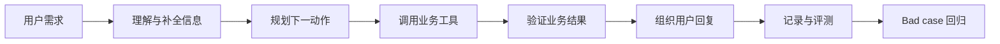

# 第 01 课：从聊天机器人到业务 Agent

## 3 分钟速记

聊天机器人主要完成“输入文本 → 输出文本”；业务 Agent 还要维护状态、选择工具、遵守权限、处理失败并验证结果。最关键的变化不是多写一个 Prompt，而是增加一个约束模型行为的执行系统。

```text
Chatbot = LLM(prompt, messages)
Agent   = Harness(LLM + State + Tools + Policy + Loop + Evaluation)
```

## 学习目标

- 区分回答质量、动作质量和业务结果质量；
- 理解为什么客服场景适合用“单主 Agent + Skills”；
- 建立本项目端到端模块地图。

## 完整闭环



如果缺少 `Verify`，工具返回成功但数据库未变化也会被误判为完成；如果缺少 `Observe`，下一次修改只能靠感觉。

## 为什么不是多个业务 Agent

订单查询、取消、换货和退货共享同一用户身份、订单上下文和政策边界。将它们做成十几个 Agent 会引入路由冲突和状态同步成本。本项目把它们实现为一个 Customer Service Agent 下的 Skills，使决策边界更清楚。

## 代码地图

| 职责 | 入口 |
| --- | --- |
| Runtime 与循环 | [runtime.py](../../backend/app/agent/runtime.py) |
| 会话状态 | [state.py](../../backend/app/agent/state.py) |
| Skills | [skills.py](../../backend/app/agent/skills.py) |
| 工具执行 | [guarded_executor.py](../../backend/app/tools/guarded_executor.py) |
| 策略门禁 | [guard.py](../../backend/app/policy/guard.py) |
| 客服服务 | [service.py](../../backend/app/support/service.py) |
| 质量评测 | [outcome_evaluator.py](../../backend/app/evaluation/outcome_evaluator.py) |

## 动手实验

1. 启动产品并登录演示用户。
2. 发送“查询全部订单”。
3. 再发送“查看第一个待处理订单”。
4. 在工程控制台找到该会话，区分 user、assistant、tool proposal、guard 和 tool execution 事件。

## 验证

```bash
curl -fsS http://127.0.0.1:8020/health
BASE_URL=http://127.0.0.1:8020 ./scripts/validate_product_stack.sh
```

## 常见误区

- 把“用了大模型”当成“做了 Agent”；
- 用最终文本是否相似代替业务结果验证；
- 为每个意图创建一个 Agent，却没有共享状态和权限模型；
- 只处理 happy path，没有确认、拒绝、超时和失败恢复。

## 课后思考

列出一次取消订单至少涉及的五种状态。哪些状态应该交给模型判断，哪些必须由确定性代码判断？

[上一页：课程主页](README.md) · [下一课：Harness、状态与 Agent Loop](02-harness-state-loop.md)

