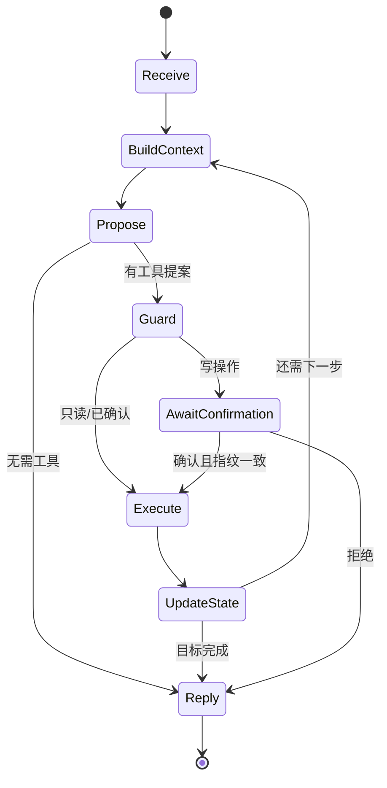

# 第 02 课：Harness、状态与 Agent Loop

## 3 分钟速记

Harness 是包住模型的执行内核。它负责组装上下文、调用 Planner、校验提案、执行工具、更新状态、判断是否继续以及记录事件。ReAct 是一种循环策略，Harness 则是承载 ReAct 或其他策略的工程系统。

## 学习目标

- 理解 Harness、Loop、State 和 Node 的职责；
- 知道一次用户 turn 为什么可能包含多次模型和工具步骤；
- 理解停止条件与失败恢复的重要性。

## 本项目的循环



循环必须有边界：最大步骤、目标完成、等待确认、转人工、规划失败和不可恢复错误都可以成为停止原因。

## 状态分层

- **消息状态**：用户、助手和工具消息；
- **身份状态**：登录用户与 Retail 用户绑定；
- **目标状态**：当前要查询、取消或退换的对象；
- **动作状态**：proposal、pending action、fingerprint；
- **观测状态**：usage、cost、latency、event trace；
- **持久化状态**：会话、反馈、错误和回归案例。

## 代码地图

- [runtime.py](../../backend/app/agent/runtime.py)：核心循环和 turn orchestration。
- [state.py](../../backend/app/agent/state.py)：状态模型。
- [session_service.py](../../backend/app/agent/session_service.py)：会话层入口。
- [session_store.py](../../backend/app/agent/session_store.py)：状态持久化边界。
- [trace.py](../../backend/app/agent/trace.py)：事件时间线。
- [progress.py](../../backend/app/agent/progress.py)：前端工作中状态。

## 动手实验

打开一次需要多个工具的会话，例如“查询全部订单”，观察同一个用户问题如何产生多次 `proposal → guard → execute → observation`。记录最终停止原因，确认它不是仅由“达到最大步骤”触发。

## 验证

```bash
rg -l "AgentRuntime|stop_reason|max_steps" backend/tests
./scripts/test_backend.sh -q
```

## 常见误区

- 把所有历史消息原样塞给模型，既昂贵又污染上下文；
- 工具执行后不把 observation 写回状态；
- 没有最大步数，错误路由可能无限循环；
- 遇到错误立即清空上下文，导致无法恢复；
- 把 Harness 等同于某个框架名称。

## 课后思考

“等待确认”为什么是正常停止状态，而不是失败？工程控制台应该如何区分两者？

[上一课](01-from-chatbot-to-agent.md) · [下一课：Planner 与 Skills](03-planner-skills.md)

