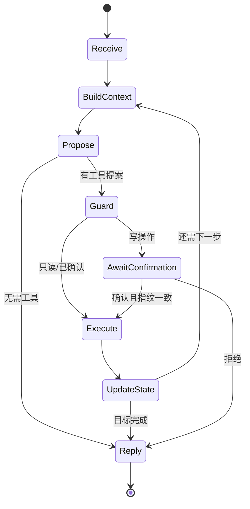
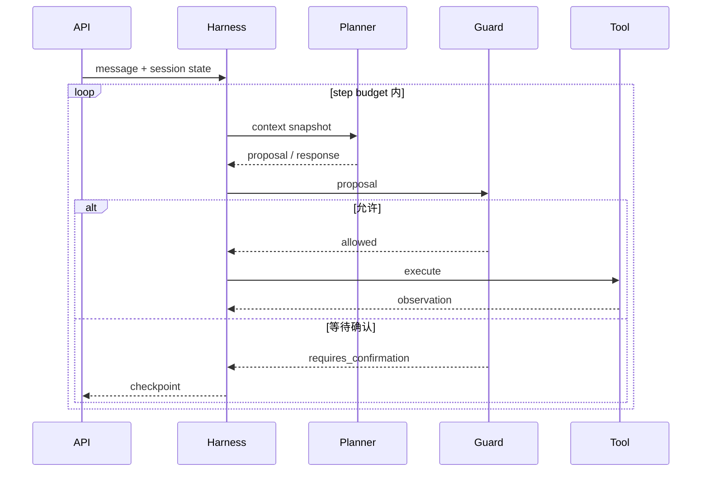

# 第 02 课：Harness、状态与 Agent Loop

## 3 分钟速记

Harness 是包住模型的执行内核。它负责组装上下文、调用 Planner、校验提案、执行工具、更新状态、判断是否继续以及记录事件。ReAct 是一种循环策略，Harness 则是承载 ReAct 或其他策略的工程系统。

## 学习目标

- 理解 Harness、Loop、State 和 Node 的职责；
- 知道一次用户 turn 为什么可能包含多次模型和工具步骤；
- 理解停止条件与失败恢复的重要性。

## 本项目的循环



循环必须有边界：最大步骤、目标完成、等待确认、转人工、规划失败和不可恢复错误都可以成为停止原因。

## 状态分层

- **消息状态**：用户、助手和工具消息；
- **身份状态**：登录用户与 Retail 用户绑定；
- **目标状态**：当前要查询、取消或退换的对象；
- **动作状态**：proposal、pending action、fingerprint；
- **观测状态**：usage、cost、latency、event trace；
- **持久化状态**：会话、反馈、错误和回归案例。

## 代码地图

- [runtime.py](../../backend/app/agent/runtime.py)：核心循环和 turn orchestration。
- [state.py](../../backend/app/agent/state.py)：状态模型。
- [session_service.py](../../backend/app/agent/session_service.py)：会话层入口。
- [session_store.py](../../backend/app/agent/session_store.py)：状态持久化边界。
- [trace.py](../../backend/app/agent/trace.py)：事件时间线。
- [progress.py](../../backend/app/agent/progress.py)：前端工作中状态。

## 动手实验

打开一次需要多个工具的会话，例如“查询全部订单”，观察同一个用户问题如何产生多次 `proposal → guard → execute → observation`。记录最终停止原因，确认它不是仅由“达到最大步骤”触发。

## 验证

```bash
rg -l "AgentRuntime|stop_reason|max_steps" backend/tests
./scripts/test_backend.sh -q
```

## 常见误区

- 把所有历史消息原样塞给模型，既昂贵又污染上下文；
- 工具执行后不把 observation 写回状态；
- 没有最大步数，错误路由可能无限循环；
- 遇到错误立即清空上下文，导致无法恢复；
- 把 Harness 等同于某个框架名称。

## 课后思考

“等待确认”为什么是正常停止状态，而不是失败？工程控制台应该如何区分两者？

## 核心概念

Harness 是 Agent 的确定性运行时。模型像一个不可靠但聪明的决策函数，Harness 则负责组装上下文、调用模型、解析输出、执行策略、记录事件、更新状态和决定是否继续。

一个健壮的 Loop 不是简单的 `while True`。它需要明确单步输入、单步输出、步数预算、停止枚举、异常边界和可恢复状态。常见停止原因包括：产生最终回答、等待确认、用户拒绝、转人工、达到步数上限、Planner 失败和工具失败。

### State 与 Trace 的区别

State 是“现在是什么情况”，适合下一步决策；Trace 是“怎么走到这里”，适合审计和调试。State 可以压缩，Trace 应追加。只存 Trace 会让每轮重放昂贵；只存 State 会失去证据。



## 本项目中的实现

- `backend/app/agent/runtime.py` 定义运行步骤与停止；
- `backend/app/agent/state.py` 定义 Agent 状态数据；
- `backend/app/agent/trace.py` 追加结构化事件；
- `backend/app/agent/session_store.py` 保存跨 HTTP 请求的会话快照；
- `backend/app/agent/progress.py` 把内部阶段投影为用户可读进度；
- `backend/app/support/streaming.py` 将进度与回复流式输出到前端。

## 执行链路

用户消息进入 API 后，Session Service 读取当前快照并追加 user event。Harness 构造 Planner 输入，得到提案后追加 `tool_proposal.accepted`。Guard 产生 allowed 或 requires_confirmation 事件。工具 observation 再进入 state，Loop 判断目标是否完成或继续下一步。每一步都保存 checkpoint，因此等待确认可以跨请求恢复。

“等待确认”是合法中间态，不是失败：系统已经完成理解、查证和动作准备，只是在等待新的外部输入。把它统计为失败会惩罚正确的安全行为。

## 设计取舍

项目采用显式状态和事件，而不是把全部历史文本重新交给模型。优点是可审计、可恢复、可测试；代价是需要设计 schema 和投影逻辑。Loop 采用单工具逐步执行，速度可能低于并行调用，但更符合 Retail policy 的“一次最多一个工具”，也更容易定位责任。

状态应区分短暂运行态与持久业务态。`current_proposal` 可以在动作结束后清理，订单状态则属于业务后端，不能只存在会话内存中。

## 失败模式

- Loop 达到步数上限：检查是否反复读取同一对象、目标 ledger 是否推进；
- 等待确认后无法恢复：检查 checkpoint 是否保存 proposal 和 fingerprint；
- 页面一直显示思考中：检查 streaming 是否发出终止事件；
- Trace 有执行事件但 State 无 observation：检查异常发生在执行后持久化前；
- 多次点击导致重复写入：需要幂等键或消费确认 checkpoint。

## 动手实验：观察状态机

运行相关测试：

```bash
./scripts/test_backend.sh -q backend/tests/agent/test_runtime.py
./scripts/test_backend.sh -q backend/tests/agent/test_session_service.py
```

然后在客服中心发起一个写操作，分别记录确认前后最后五个 Trace 事件。解释每个事件修改了什么 State，以及下一步为什么能从 checkpoint 继续。

[上一课](01-from-chatbot-to-agent.md) · [下一课：Planner 与 Skills](03-planner-skills.md)

