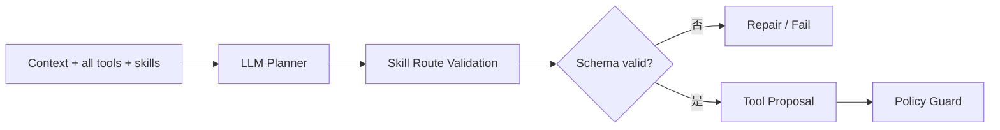

# 第 03 课：LLM Planner、Skills 与结构化提案

## 3 分钟速记

Planner 的职责是提出“下一步做什么”，不是直接操作数据库。模型输出必须先解析成受约束的 Tool Proposal，随后仍要经过 schema、身份和 Policy Guard 校验。

## 学习目标

- 理解 LLM Planner 和 Rule Planner 的定位；
- 理解 Skill routing 与工具选择的差别；
- 读懂结构化 proposal、usage 和错误恢复。

## 决策与执行分离


模型可以犯错，但错误应该在 `Parse`、`Validate` 或 `Guard` 被显式识别，而不是直接变成业务副作用。

## Skill 是什么

Skill 把一个业务能力需要的工具、前置条件和上下文提示组织在一起。例如退货 Skill 关心：用户是否已绑定、订单是否属于该用户、订单是否 delivered、商品项是否存在以及是否完成确认。

Skill 不应复制底层工具实现；它提供的是业务路由与约束。

## 代码地图

- [proposal_generator.py](../../backend/app/agent/proposal_generator.py)：LLM/Rule proposal generator。
- [skills.py](../../backend/app/agent/skills.py)：Skill catalog 与选择。
- [order_identity.py](../../backend/app/agent/order_identity.py)：订单 ID 规范化；更完整的上下文恢复位于 Planner 与 Runtime。
- [response_quality.py](../../backend/app/agent/response_quality.py)：输出质量约束。
- [.env.example](../../.env.example)：默认 LLM 配置。

## 为什么保留 Rule

产品默认是 `llm`。Rule 仍有三个用途：单元测试的确定性夹具、快速定位工具链问题、在模型服务不可用时验证 Guard/MCP 是否正常。Rule 不是产品的主要智能来源。

## 动手实验

对同一个问题分别运行 LLM 与 Rule 回归，比较动作序列、参数、停止原因、Token、成本和业务结果。不要只比较最终回答。

```bash
ECOM_AGENT_PROPOSAL_GENERATOR=llm ./scripts/run_runtime_regression.sh
ECOM_AGENT_PROPOSAL_GENERATOR=rule ./scripts/run_runtime_regression.sh
```

## 验证清单

- 模型返回非 JSON 时能否重试或优雅失败？
- 提案中的工具名是否必须来自 catalog？
- 参数是否经过 schema 校验？
- usage 缺失时是否明确显示不可用，而不是伪造为 0？
- Planner 是否能够利用上轮已经解析的订单？

## 常见误区

- 在 Prompt 里写“请谨慎”就认为安全；
- 让模型自行判断自己是否有权限；
- Tool description 过长且互相重叠，导致路由混乱；
- 用 expected trajectory 强行控制真实 Agent；
- 每次模型调用都丢弃 usage，导致成本台永远为零。

## 核心概念

Planner 的职责是把“当前状态 + 可用能力 + 用户目标”转换为下一步结构化提案。它没有执行权。理想输出不是一段夹杂 JSON 的自然语言，而是可验证的联合类型：回复、工具提案、请求澄清或转人工。

Skill 是任务局部的决策边界：它提供目标、适用条件、允许工具、关键约束和少量示例。Skill 不应复制全部系统 policy，也不应成为可以绕过 Guard 的第二套权限系统。

### 为什么结构化输出重要

文本“请取消订单 W123”不能安全执行，因为工具名、参数类型和意图边界不明确。结构化提案至少需要 tool name、arguments、rationale 和可追踪的 planner metadata。解析失败应成为显式错误，而不是猜测文本。



## 本项目中的实现

- `backend/app/agent/proposal_generator.py` 封装 rule/LLM Planner 和 usage；
- `backend/app/agent/skills.py` 定义任务 Skill 与可用工具；
- `backend/app/agent/order_identity.py` 只负责订单 ID 规范化；目标恢复主要位于 `proposal_generator.py`、State 与 Runtime fallback；
- `backend/app/agent/audit.py` 记录 rationale 和 Planner 元数据；
- `backend/app/agent/response_composer.py` 将证据组织成最终回复。

## 执行链路

输入“取消刚才那个订单”时，当前 LLM Planner 会同时看到完整工具与 Skill 列表，并输出 `skill_id`、`skill_action` 和工具提案；Runtime 随后用 `route_skill_action()` 做确定性解析与校验。参数恢复会利用结构化上下文与 fallback，而不是只靠文本猜测。当前并不存在一个在模型调用前先缩小工具集合的独立 Router。

Rule Planner 在产品默认路径中不是主角，但它是确定性对照组：可以验证 Tool/Guard/MCP 链路，而不把模型波动混入故障定位。真实 LLM 的性能和成本则需要单独观测。

## 设计取舍

把所有工具一次性暴露给模型实现最简单，但工具越多，名称相似、参数冲突和误选越多。当前项目采用“模型选择 Skill、确定性代码后置校验”，还没有通过前置 Router 真正缩小模型动作空间。未来若增加前置路由，可以换取更稳定的决策，但 Router 自身也必须评测，错误路由可能让正确工具根本不可见。

项目保留有限 repair，而不做无限自我修复。无界 repair 会掩盖 schema 或 prompt 问题，并增加成本。恢复次数、错误类型和最终停止原因都应进入 Trace。

## 失败模式

- Planner 返回自然语言而非 schema：检查模型结构化输出能力和解析错误；
- 选对工具但参数属于另一订单：检查 context projection 和目标恢复；
- 重复调用只读工具：检查 objective ledger 是否标记已获得信息；
- 过早回复“无法处理”：检查 Skill 工具范围和终止判断；
- Token/成本为零：确认 provider usage 是否穿过 Planner 适配层。

## 动手实验：比较决策而非文案

在回归页用同一任务分别运行 rule 与 llm Planner，比较：Skill、动作序列、第一处偏差、停止原因、业务结果、Token 和成本。不要只比较最终中文回复。

思考：如果两条轨迹不同但最终订单都正确取消，哪个指标应该通过？答案会在第 09 课展开。

### 进一步练习

为“修改默认地址”设计一个 Skill：写出适用条件、允许工具、必需参数、禁止行为和结束条件。再故意删除地址 ID，观察 Planner 应当请求澄清还是先查询地址列表。这个练习用于区分“模型缺少信息”和“模型选择错误”。

当你能让同一 Skill 在 rule 与 LLM Planner 下共享 Tool Proposal schema，并被同一个 Guard 审核时，决策层与执行层才真正解耦。

[上一课](02-harness-state-loop.md) · [下一课：MCP 工具层](04-mcp-tools.md)

