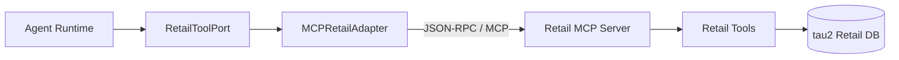

# 第 04 课：MCP 工具层与 Retail 业务

## 3 分钟速记

MCP 解决“模型应用如何发现并调用外部能力”的标准化问题。它不会自动保证权限、安全或业务正确；这些仍由 Agent 侧的身份边界、Guard 和结果验证负责。

## 学习目标

- 理解 Tool Port、Adapter、MCP Server 和业务数据的边界；
- 认识 Retail 域中的读写工具；
- 掌握工具目录、schema 与连接状态的排查方法。

## 架构



`RetailToolPort` 使 Runtime 不依赖某个传输协议。测试可以使用替身，产品使用 MCP Adapter，业务工具的 schema 则由 MCP Server 暴露。

## 工具分类

- 身份：按邮箱或姓名 + 邮编查找用户；
- 查询：用户、订单、商品详情；
- 待处理订单：取消、修改地址、修改商品；
- 已送达订单：退货、换货；
- 升级：转人工。

读工具通常可以直接执行；写工具必须进入确认门禁。

## 代码地图

- [retail_port.py](../../backend/app/tools/retail_port.py)：业务工具协议。
- [mcp_retail_adapter.py](../../backend/app/tools/mcp_retail_adapter.py)：MCP Client Adapter。
- [retail_server.py](../../backend/app/mcp/retail_server.py)：MCP Server。
- [tool_backend_factory.py](../../backend/app/tools/tool_backend_factory.py)：后端选择。
- [tau_retail_adapter.py](../../backend/app/tools/tau_retail_adapter.py)：直接 Python 适配器，用于测试与兼容。

## 动手实验

```bash
./scripts/run_retail_mcp.sh
```

另开终端启动 API，访问 `/tools`，检查工具名、参数 schema、是否为写操作以及后端状态：

```bash
curl -fsS http://127.0.0.1:8020/tools
curl -fsS http://127.0.0.1:8020/health
```

## 排查顺序

1. MCP 服务是否监听；
2. initialize 是否成功；
3. tools/list 是否返回预期目录；
4. 参数是否符合 schema；
5. Tool Adapter 是否保留错误类型；
6. Agent 是否把工具 observation 写回 trace。

## 常见误区

- “用了 MCP”就认为所有工具都安全；
- 把 MCP Server 和 Agent Runtime 写在一个巨大类里；
- 工具描述包含模糊重叠的动作；
- 远程调用超时后自动重试写操作，可能造成重复副作用；
- 把测试数据直接当作生产数据源。

## 课后思考

如果未来切换到真实电商 API，哪些模块应该保持不变？哪些模块必须重新实现？

[上一课](03-planner-skills.md) · [下一课：Policy Guard 与 HITL](05-policy-hitl.md)

