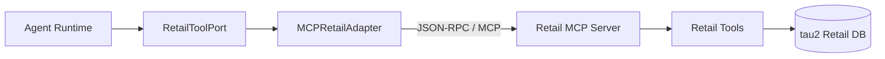
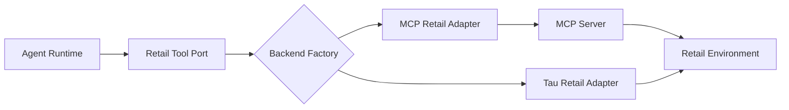

# 第 04 课：MCP 工具层与 Retail 业务

## 3 分钟速记

MCP 解决“模型应用如何发现并调用外部能力”的标准化问题。它不会自动保证权限、安全或业务正确；这些仍由 Agent 侧的身份边界、Guard 和结果验证负责。

## 学习目标

- 理解 Tool Port、Adapter、MCP Server 和业务数据的边界；
- 认识 Retail 域中的读写工具；
- 掌握工具目录、schema 与连接状态的排查方法。

## 架构



`RetailToolPort` 使 Runtime 不依赖某个传输协议。测试可以使用替身，产品使用 MCP Adapter，业务工具的 schema 则由 MCP Server 暴露。

## 工具分类

- 身份：按邮箱或姓名 + 邮编查找用户；
- 查询：用户、订单、商品详情；
- 待处理订单：取消、修改地址、修改商品；
- 已送达订单：退货、换货；
- 升级：转人工。

读工具通常可以直接执行；写工具必须进入确认门禁。

## 代码地图

- [retail_port.py](../../backend/app/tools/retail_port.py)：业务工具协议。
- [mcp_retail_adapter.py](../../backend/app/tools/mcp_retail_adapter.py)：MCP Client Adapter。
- [retail_server.py](../../backend/app/mcp/retail_server.py)：MCP Server。
- [tool_backend_factory.py](../../backend/app/tools/tool_backend_factory.py)：后端选择。
- [tau_retail_adapter.py](../../backend/app/tools/tau_retail_adapter.py)：直接 Python 适配器，用于测试与兼容。

## 动手实验

```bash
./scripts/run_retail_mcp.sh
```

另开终端启动 API，访问 `/tools`，检查工具名、参数 schema、是否为写操作以及后端状态：

```bash
curl -fsS http://127.0.0.1:8020/tools
curl -fsS http://127.0.0.1:8020/health
```

## 排查顺序

1. MCP 服务是否监听；
2. initialize 是否成功；
3. tools/list 是否返回预期目录；
4. 参数是否符合 schema；
5. Tool Adapter 是否保留错误类型；
6. Agent 是否把工具 observation 写回 trace。

## 常见误区

- “用了 MCP”就认为所有工具都安全；
- 把 MCP Server 和 Agent Runtime 写在一个巨大类里；
- 工具描述包含模糊重叠的动作；
- 远程调用超时后自动重试写操作，可能造成重复副作用；
- 把测试数据直接当作生产数据源。

## 课后思考

如果未来切换到真实电商 API，哪些模块应该保持不变？哪些模块必须重新实现？

## 核心概念

Tool 是 Agent 可以调用的能力；MCP 是描述、发现和调用这些能力的协议边界；Port 是业务侧稳定接口；Adapter 把某个具体后端转换成 Port。四者不是同义词。

一个工具契约至少包含名称、用途、输入 schema、输出 schema、错误语义和副作用分类。对业务 Agent 而言，“调用成功”还应区分协议成功、工具执行成功和业务状态成功。



## 本项目中的实现

- `backend/app/tools/retail_port.py` 定义稳定的 Retail 工具边界；
- `backend/app/tools/mcp_retail_adapter.py` 通过 MCP 调用工具；
- `backend/app/tools/tau_retail_adapter.py` 对接本地 tau2 Retail；
- `backend/app/tools/tool_backend_factory.py` 按配置选择后端；
- `backend/app/mcp/retail_server.py` 暴露 MCP Server；
- `backend/app/tools/guarded_executor.py` 在调用前强制策略检查。

## 执行链路

Planner 只产生 `cancel_pending_order` 提案，不接触数据库。Executor 依据 Port 调用，MCP Adapter 将参数编码为协议请求，Server 调用 Retail 环境并返回 observation。Runtime 把 observation 追加到状态和 Trace，必要时再发起一次读取验证。

MCP 管理的是工具协议，不自动解决业务权限。Server 暴露了工具，并不代表当前用户有权调用；权限仍由认证上下文、Policy Guard 和业务后端共同保证。

## 设计取舍

Port/Adapter 增加了一层代码，却让 Planner、Guard 和评测不依赖具体后端。未来从 tau2 fixture 切换到真实订单 API，主要替换 Adapter，同时保持工具语义和测试契约。

当前项目坚持一次一个工具调用。并行读取理论上更快，但会增加事件排序、速率限制和错误合并复杂度；写操作更不应并行。只有当业务依赖图和策略明确允许时，才值得增加并行执行器。

## 错误分层

| 层次 | 示例 | 处理方式 |
| --- | --- | --- |
| 协议错误 | MCP 超时、JSON 解码失败 | 重试或服务降级 |
| schema 错误 | 缺少 order_id | 返回 Planner 修复或终止 |
| 权限错误 | 操作其他用户订单 | Guard/后端拒绝，不重试 |
| 业务错误 | delivered 订单不能取消 | 转换为可解释 observation |
| 结果不一致 | 返回成功但状态未改变 | 标记 outcome failure |

## 失败模式

- 工具在列表中但 Planner 看不到：检查 Skill 的工具白名单；
- MCP 正常但业务报错：不要把业务错误归类为协议故障；
- 后端切换后参数名不同：Adapter 应吸收差异，不应污染 Planner；
- 测试直接调用底层环境：会绕过 Guard，无法证明真实执行链；
- 日志记录完整参数：可能泄露地址、电话或账户信息。

## 动手实验：验证可替换边界

```bash
./scripts/test_backend.sh -q backend/tests/tools
./scripts/test_backend.sh -q backend/tests/mcp
```

选择一个只读工具，画出从 Proposal 到 Retail fixture 的每个函数边界。然后假设真实 API 把订单 ID 改为数字，指出应该在哪一层转换，以及哪些上层测试不应变化。

[上一课](03-planner-skills.md) · [下一课：Policy Guard 与 HITL](05-policy-hitl.md)

