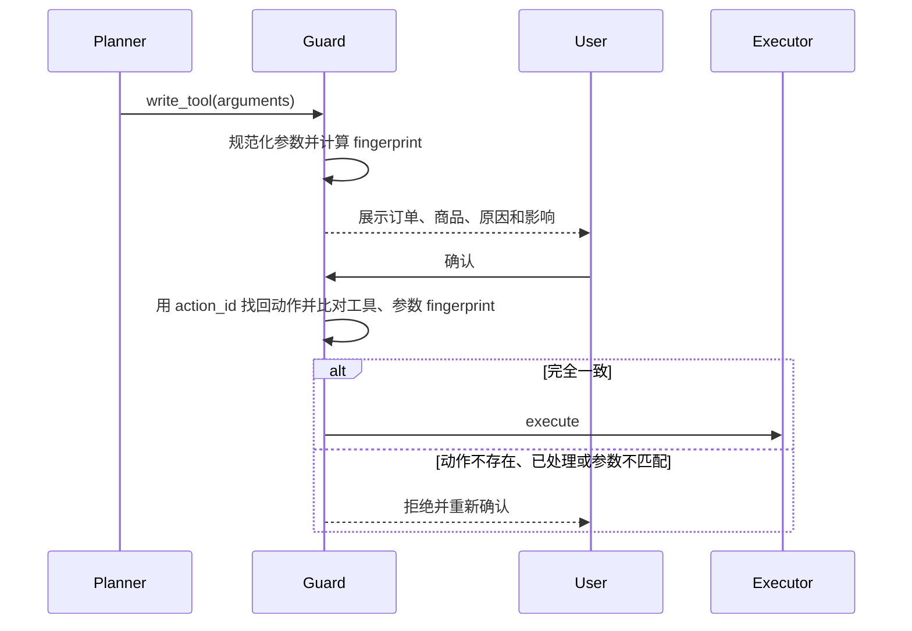
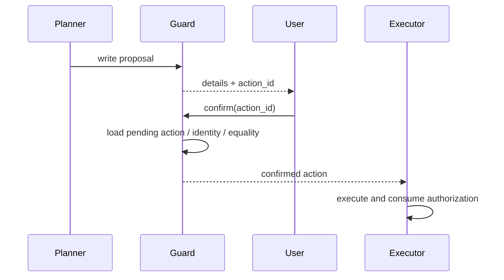

# 第 05 课：Policy Guard、权限与 Human-in-the-loop

## 3 分钟速记

安全边界不能只写在 Prompt 里。模型负责提出动作，确定性 Guard 负责判断能否执行。当前实现用工具名+参数 fingerprint 与服务端 pending `action_id` 约束确认；用户/会话/过期/资源版本绑定仍是生产强化项。

## 学习目标

- 理解为什么 Prompt policy 不能替代代码 policy；
- 理解 action fingerprint 如何防止“确认 A，执行 B”；
- 设计确认、拒绝、过期和重复提交行为。

## 两阶段写操作



## 权限层次

1. 登录态：请求属于哪个应用账户；
2. 角色：customer 或 developer；
3. Retail 绑定：该账户对应哪个业务用户；
4. 资源所有权：订单是否属于当前业务用户；
5. 状态约束：pending 才能取消，delivered 才能退换；
6. 用户确认：写操作详情是否获得明确同意。

## 代码地图

- [guard.py](../../backend/app/policy/guard.py)：动作分类、fingerprint 和确认判断。
- [guarded_executor.py](../../backend/app/tools/guarded_executor.py)：统一执行入口。
- [retail_identity.py](../../backend/app/auth/retail_identity.py)：身份映射。
- [audit.py](../../backend/app/agent/audit.py)：写操作审计。

## 动手实验

1. 请求取消一个 pending 订单；
2. 在确认前检查订单状态未变化；
3. 回复无关文本，确认不能触发执行；
4. 明确确认，检查 MCP 调用与订单新状态；
5. 重复发送“确认”，验证不会重复取消。

## 验证

```bash
rg -l "fingerprint|requires_confirmation|pending_action" backend/tests
./scripts/test_backend.sh -q
```

## 常见误区

- 用户说“帮我处理”就视为确认；
- 只保存工具名，不保存完整规范化参数；
- Planner 在等待确认期间重新生成了不同参数；
- 对写工具盲目重试；
- 只验证 HTTP 成功，不读取业务状态；
- 登录后取消所有资源级权限校验。

## 课后思考

修改地址时，确认页至少应该显示哪些字段？哪些字段变化会导致旧 fingerprint 失效？

## 核心概念

Policy Guard 是确定性授权层。Prompt 可以告诉模型“写操作前请确认”，但 prompt 不是安全边界：模型可能忽略、误解或被注入。真正的约束必须位于所有工具调用都会经过的执行路径上。

通用 Guard 常见决策不是布尔值，而是 `allowed / requires_confirmation / denied`。本项目 `GuardDecisionType` 当前只有 `allow` 与 `require_confirmation`；身份越权由 Executor 额外产生 `policy_guard.identity_denied`。读取本人订单通常允许，写操作进入确认路径。

### Action fingerprint

确认应当绑定“用户看到的那个动作”。当前 Guard 的 fingerprint 只由工具名和规范化参数生成；用户侧提交的是服务端 `action_id`，服务再找回 pending action。它能阻止同一 pending action 被静默换参，但尚未把用户、会话、过期时间或业务资源版本纳入 fingerprint，也不是完整的 TOCTOU 防护。



## 本项目中的实现

- `backend/app/policy/guard.py` 分类动作并返回策略决策；
- `backend/app/tools/guarded_executor.py` 把 Guard 放在执行必经路径；
- `backend/app/agent/state.py` 保存 pending proposal 与确认状态；
- `backend/app/support/streaming.py` 向前端发送确认卡片；
- `backend/app/auth/retail_identity.py` 把登录用户绑定到 Retail 身份。

## 执行链路

取消提案进入 Guard 后，系统生成确认摘要并保存 pending action。用户确认时不重新让模型解释意图，而是提交 `action_id`；服务端 claim pending action，并将对应工具名+参数 fingerprint 加入确认集合。数据库 claim 提供了部分重复提交保护，但当前 fingerprint 不会按一次执行消费，也没有过期和业务版本语义；这些是生产强化项，不能视为已经解决。

## 设计取舍

项目采用两阶段写操作，牺牲一次交互换取可理解授权。对于低风险读取自动执行；对于跨用户访问直接拒绝；只有真正的业务写入进入 HITL，避免所有动作都弹窗导致确认疲劳。

人工接管与 HITL 不同：HITL 是用户批准具体动作，handoff 是把整个会话控制权交给人工客服。两者都需要审计，但生命周期和权限不同。

## 失败模式

- 只在 prompt 中要求确认：模型偏离就会绕过；
- action_id 没有绑定正确会话和用户：可能产生越权确认；
- fingerprint 没有过期、消费和资源版本：相同参数可能重用旧授权；
- 只校验订单存在，不校验归属：形成越权；
- 前端隐藏确认卡片但后端仍 pending：状态不一致。

## 动手实验：证明门禁有效

```bash
./scripts/test_backend.sh -q backend/tests/policy
./scripts/test_backend.sh -q backend/tests/tools/test_guarded_executor.py
```

构造一个取消提案并记录 `action_id` 与 fingerprint；修改服务端 pending action 参数后确认，预期参数匹配应失败。随后重复提交同一 `action_id`，检查数据库 claim 的行为。最后阅读 Guard 代码，列出当前 fingerprint 为达到一次性、带过期且绑定资源版本还缺哪些字段与状态。

## 知识检查

为什么“用户刚才说过可以取消”不能替代当前动作确认？因为自然语言授权缺少精确参数、时效和一次性语义，无法抵御上下文漂移与 TOCTOU。

[上一课](04-mcp-tools.md) · [下一课：Context 与 Memory](06-context-memory.md)

