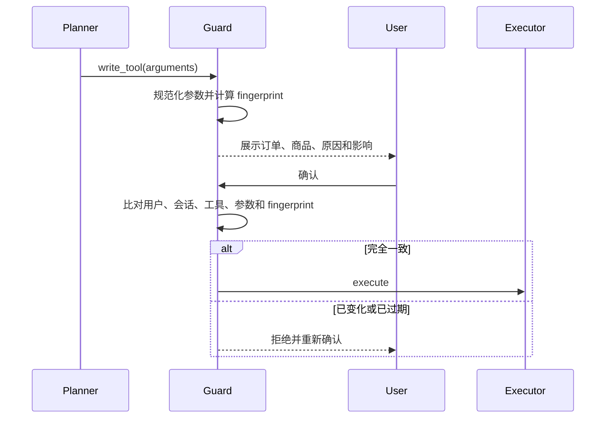

# 第 05 课：Policy Guard、权限与 Human-in-the-loop

## 3 分钟速记

安全边界不能只写在 Prompt 里。模型负责提出动作，确定性 Guard 负责判断能否执行；高风险写操作先生成不可歧义的动作指纹，用户确认后只执行完全相同的动作。

## 学习目标

- 理解为什么 Prompt policy 不能替代代码 policy；
- 理解 action fingerprint 如何防止“确认 A，执行 B”；
- 设计确认、拒绝、过期和重复提交行为。

## 两阶段写操作



## 权限层次

1. 登录态：请求属于哪个应用账户；
2. 角色：customer 或 developer；
3. Retail 绑定：该账户对应哪个业务用户；
4. 资源所有权：订单是否属于当前业务用户；
5. 状态约束：pending 才能取消，delivered 才能退换；
6. 用户确认：写操作详情是否获得明确同意。

## 代码地图

- [guard.py](../../backend/app/policy/guard.py)：动作分类、fingerprint 和确认判断。
- [guarded_executor.py](../../backend/app/tools/guarded_executor.py)：统一执行入口。
- [retail_identity.py](../../backend/app/auth/retail_identity.py)：身份映射。
- [audit.py](../../backend/app/agent/audit.py)：写操作审计。

## 动手实验

1. 请求取消一个 pending 订单；
2. 在确认前检查订单状态未变化；
3. 回复无关文本，确认不能触发执行；
4. 明确确认，检查 MCP 调用与订单新状态；
5. 重复发送“确认”，验证不会重复取消。

## 验证

```bash
rg -l "fingerprint|requires_confirmation|pending_action" backend/tests
./scripts/test_backend.sh -q
```

## 常见误区

- 用户说“帮我处理”就视为确认；
- 只保存工具名，不保存完整规范化参数；
- Planner 在等待确认期间重新生成了不同参数；
- 对写工具盲目重试；
- 只验证 HTTP 成功，不读取业务状态；
- 登录后取消所有资源级权限校验。

## 课后思考

修改地址时，确认页至少应该显示哪些字段？哪些字段变化会导致旧 fingerprint 失效？

[上一课](04-mcp-tools.md) · [下一课：Context 与 Memory](06-context-memory.md)

