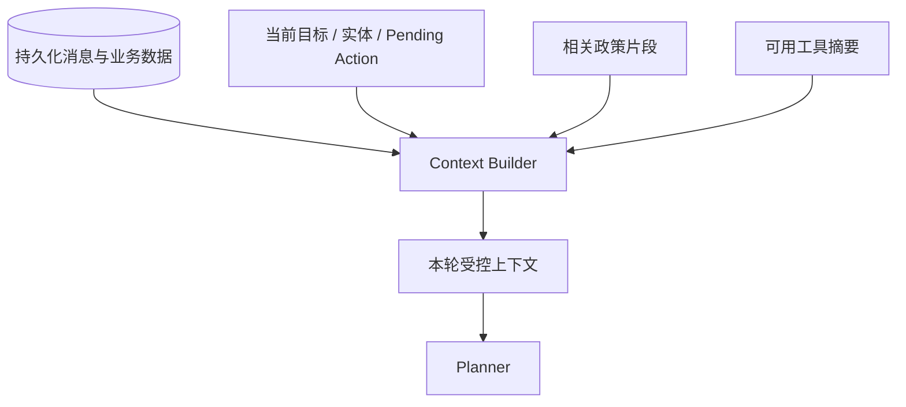
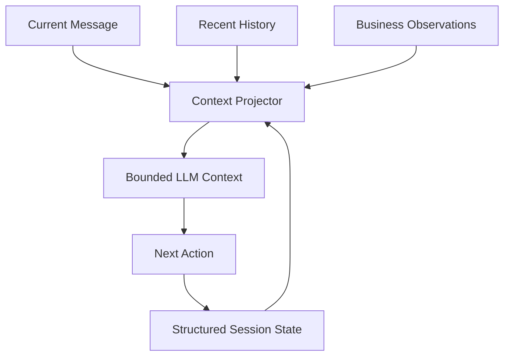

# 第 06 课：Context、Memory 与身份边界

## 3 分钟速记

历史消息是原始记录，Context 是本轮真正交给模型的信息，Memory 是跨轮保留且可复用的状态。好的 Context Engineering 不是把全部历史塞进窗口，而是保留与当前目标相关、来源明确、权限允许的信息。

## 学习目标

- 区分 message history、working state 和长期数据；
- 理解指代恢复和业务目标 ledger；
- 理解登录身份如何限制每次检索和工具调用。

## 三层上下文



“取消订单”应继承上轮明确谈论的订单，但不能随意选择账户中的其他 pending 订单。当前目标、候选实体和歧义状态应显式保存，而不是依赖模型猜测。

## 本项目的策略

- 登录后账户绑定唯一 Retail 用户；
- 会话只能访问该用户订单；
- 保存多轮消息和业务目标；
- 已解析订单可供下一轮指代恢复；
- pending confirmation 是强状态，优先处理确认/拒绝；
- 空会话不会长期残留在历史列表；
- 逻辑删除保留审计数据，但不再向用户展示。

## 代码地图

- [state.py](../../backend/app/agent/state.py)：working state。
- [order_identity.py](../../backend/app/agent/order_identity.py)：订单指代与锁定。
- [session_store.py](../../backend/app/agent/session_store.py)：会话存储。
- [repositories.py](../../backend/app/persistence/repositories.py)：持久化访问。
- [service.py](../../backend/app/support/service.py)：用户会话边界。
- [008_conversation_management.sql](../../backend/app/persistence/migrations/008_conversation_management.sql)：会话管理字段。

## 动手实验

按顺序发送：

1. “订单 #W8770097 可以退货吗？”
2. “那就取消订单。”
3. “确认。”

检查第二轮 proposal 是否仍指向 `#W8770097`，而不是列出所有 pending 订单。再用另一个登录用户访问该会话或订单，确认被拒绝。

## 设计 Memory 时问四个问题

- 保存什么：原文、摘要、实体还是偏好？
- 保存多久：本 turn、本会话还是跨会话？
- 谁能读取：同一用户、开发人员还是系统任务？
- 如何遗忘：过期、逻辑删除、压缩还是用户主动清除？

## 常见误区

- 把完整工具 JSON 永久重复放进 Prompt；
- 仅靠“最近 N 条消息”实现业务记忆；
- 同一会话允许切换业务用户；
- 删除 UI 卡片但数据库仍在默认查询中返回；
- 摘要丢失订单号、确认状态等关键事实。

## 核心概念

Context 是一次推理可见的信息；Memory 是信息跨步骤保存与恢复的机制。两者不等价。把全部聊天记录塞进 context 是最简单的短期记忆，但成本会增长，旧信息会干扰新决策，也不能替代业务数据库。

本课程把记忆分为四层：对话历史、结构化会话状态、业务系统事实、可选长期偏好。订单状态属于业务事实，pending proposal 属于会话状态，用户说过的话属于对话历史；不能混存。



### 身份是记忆边界

登录成功后，会话绑定唯一 customer identity。后续“我的订单”只能投影该用户的数据。新会话可以恢复用户身份，但不能继承另一个用户的订单 observation。任何跨用户长期记忆都必须有明确数据模型、用途和删除规则。

## 本项目中的实现

- `backend/app/agent/session_store.py` 保存会话状态；
- `backend/app/agent/order_identity.py` 恢复订单指代；
- `backend/app/support/projector.py` 把持久记录投影为前端会话；
- `backend/app/persistence/repositories.py` 提供会话与消息持久化；
- `backend/app/auth/retail_identity.py` 负责应用账户与 Retail 用户映射；
- `backend/app/support/service.py` 实现会话归属、重命名、置顶、分组和逻辑删除。

## 执行链路

第一轮查询返回三个订单，Runtime 将结构化订单 observation 写入 state。第二轮用户说“办公椅那个”，目标恢复逻辑基于当前用户、最近 observation 和商品信息选择订单 ID。Planner 得到的是明确目标，而不是仅靠语言猜测。

会话逻辑删除后，默认列表查询必须排除它；空白会话不应长期占据列表。分组、置顶和标题属于产品元数据，不应混入 Planner 的业务上下文。

## 设计取舍

项目优先保存结构化事实，而不是自动生成无限摘要。结构化字段更容易校验和迁移，摘要只适合压缩叙事。当前没有跨会话向量长期记忆，这是刻意限制：客服场景首先需要身份隔离和可删除性，而不是“记住用户的一切”。

上下文投影应最小化：Planner 只看到完成当前目标所需的订单、工具结果和政策片段。更大的 context 不必然更聪明，反而增加泄露、冲突和 Token 成本。

## 失败模式

- 用户切换后仍看到旧订单：身份绑定或缓存键错误；
- “那个订单”恢复到错误对象：候选集合没有限定当前用户和最近观察；
- 新会话继承 pending 写操作：危险状态未在边界清理；
- 删除后重新出现：列表查询没有过滤逻辑删除字段；
- 标题摘要泄露敏感信息：生成与展示前缺少脱敏。

## 动手实验：验证身份隔离

使用两个演示客户分别登录，各自查询订单并创建会话。验证 A 的会话 ID、订单号或分组接口不能被 B 读取或修改。然后测试逻辑删除：删除后立即从默认列表消失，但审计数据仍可由有权限的工程流程保留。

```bash
./scripts/test_backend.sh -q backend/tests/auth
./scripts/test_backend.sh -q backend/tests/support
```

## 知识检查

如果要增加“记住用户喜欢简洁回答”，它属于哪一层？需要怎样的同意、作用域、更新和删除机制？只有回答这些问题，长期记忆才不是隐私债务。

[上一课](05-policy-hitl.md) · [下一课：Policy RAG](07-policy-rag.md)

