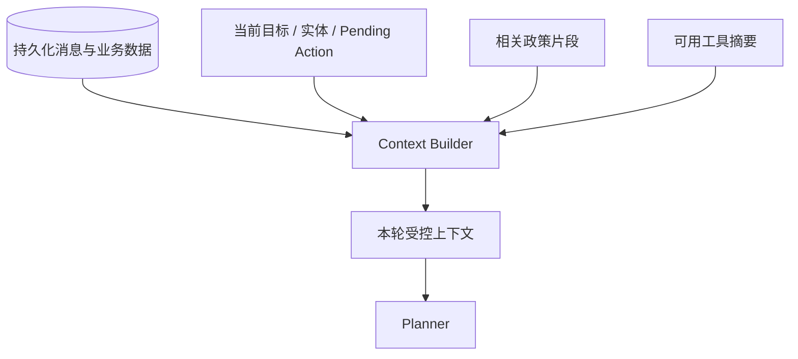

# 第 06 课：Context、Memory 与身份边界

## 3 分钟速记

历史消息是原始记录，Context 是本轮真正交给模型的信息，Memory 是跨轮保留且可复用的状态。好的 Context Engineering 不是把全部历史塞进窗口，而是保留与当前目标相关、来源明确、权限允许的信息。

## 学习目标

- 区分 message history、working state 和长期数据；
- 理解指代恢复和业务目标 ledger；
- 理解登录身份如何限制每次检索和工具调用。

## 三层上下文

“取消订单”应继承上轮明确谈论的订单，但不能随意选择账户中的其他 pending 订单。当前目标、候选实体和歧义状态应显式保存，而不是依赖模型猜测。

## 本项目的策略

- 登录后账户绑定唯一 Retail 用户；
- 会话只能访问该用户订单；
- 保存多轮消息和业务目标；
- 已解析订单可供下一轮指代恢复；
- pending confirmation 是强状态，优先处理确认/拒绝；
- 空会话不会长期残留在历史列表；
- 逻辑删除保留审计数据，但不再向用户展示。

## 代码地图

- [state.py](../../backend/app/agent/state.py)：working state。
- [order_identity.py](../../backend/app/agent/order_identity.py)：订单指代与锁定。
- [session_store.py](../../backend/app/agent/session_store.py)：会话存储。
- [repositories.py](../../backend/app/persistence/repositories.py)：持久化访问。
- [service.py](../../backend/app/support/service.py)：用户会话边界。
- [008_conversation_management.sql](../../backend/app/persistence/migrations/008_conversation_management.sql)：会话管理字段。

## 动手实验

按顺序发送：

1. “订单 #W8770097 可以退货吗？”
2. “那就取消订单。”
3. “确认。”

检查第二轮 proposal 是否仍指向 `#W8770097`，而不是列出所有 pending 订单。再用另一个登录用户访问该会话或订单，确认被拒绝。

## 设计 Memory 时问四个问题

- 保存什么：原文、摘要、实体还是偏好？
- 保存多久：本 turn、本会话还是跨会话？
- 谁能读取：同一用户、开发人员还是系统任务？
- 如何遗忘：过期、逻辑删除、压缩还是用户主动清除？

## 常见误区

- 把完整工具 JSON 永久重复放进 Prompt；
- 仅靠“最近 N 条消息”实现业务记忆；
- 同一会话允许切换业务用户；
- 删除 UI 卡片但数据库仍在默认查询中返回；
- 摘要丢失订单号、确认状态等关键事实。

[上一课](05-policy-hitl.md) · [下一课：Policy RAG](07-policy-rag.md)

