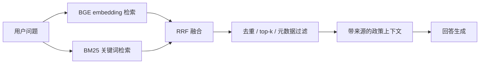
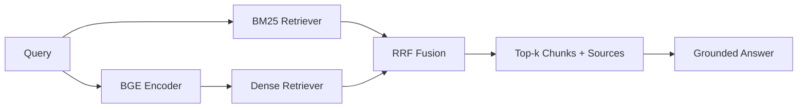

# 第 07 课：BGE + BM25 + RRF Policy RAG

## 3 分钟速记

政策检索既需要语义相似，也需要精确匹配订单状态、时限和术语。项目使用 BGE 捕捉语义、BM25 捕捉关键词，再用 Reciprocal Rank Fusion 合并名次，避免依赖两种分数的绝对尺度。

## 学习目标

- 理解稠密检索、稀疏检索和融合排序；
- 理解政策语料的来源与法律边界；
- 会运行离线检索评测并分析失败 query。

## 检索链路



RRF 常用形式：

```text
score(d) = Σ 1 / (k + rank_i(d))
```

它关注每个候选在不同检索器中的排名，而不要求 cosine score 和 BM25 score 可直接比较。

## 代码地图

- [embedding.py](../../backend/app/rag/embedding.py)：BGE embedding。
- [retrieval.py](../../backend/app/rag/retrieval.py)：BM25、dense 与 RRF。
- [ingestion.py](../../backend/app/rag/ingestion.py)：语料加载与索引。
- [evaluation.py](../../backend/app/rag/evaluation.py)：检索评测。
- [taobao_policies.json](../../backend/app/rag/corpus/taobao_policies.json)：教学政策语料。
- [evaluation_queries.json](../../backend/app/rag/corpus/evaluation_queries.json)：评测查询。

## 语料声明

当前政策语料用于模拟接近真实电商的售后规则与检索场景，不是淘宝官方实时政策，也不应以“淘宝承诺”对外发布。生产系统需要保留来源 URL、版本、生效时间和业务审核人。

## 动手实验

```bash
./scripts/download_policy_embedding_model.sh
benchmarks/.venv/bin/python scripts/evaluate_policy_rag.py
```

选择一个稠密检索失败但 BM25 命中的查询，再选择一个 BM25 失败但语义检索命中的查询，比较融合结果。

## 评测建议

- Recall@k：正确政策是否被召回；
- MRR：正确结果是否足够靠前；
- 引用准确率：回答引用是否真的支持结论；
- 无答案识别：语料没有依据时是否拒绝编造；
- 新鲜度：政策变更后索引是否按版本更新。

## 常见误区

- 把整篇政策作为一个 chunk；
- 用问题本身作为“标准答案”；
- 只测试几个成功案例；
- 检索到文本就允许模型扩写不存在的条件；
- 不保存来源和政策版本；
- embedding 模型下载失败时静默退化却不展示状态。

## 核心概念

RAG 把知识检索和语言生成分开：索引阶段清洗、切分并建立稀疏/稠密表示；查询阶段召回、融合、重排，把证据连同来源交给回答器。它降低模型凭空编造政策的概率，但不会自动保证答案正确。

BM25 依赖词项匹配，对订单、时限、政策名称等精确词表现稳定；BGE embedding 捕捉语义相似，适合“收到货后不想要了怎么办”这类表达。RRF 用排名而不是原始分数融合两路结果：

`RRF(d) = Σ 1 / (k + rank_i(d))`

这样避免 BM25 分数与向量相似度尺度不可比。



## 本项目中的实现

- `backend/app/rag/ingestion.py` 负责政策文档切分和索引输入；
- `backend/app/rag/embedding.py` 加载 `bge-small-zh-v1.5`；
- `backend/app/rag/retrieval.py` 实现 BM25、dense 与 RRF；
- `backend/app/rag/models.py` 定义 chunk、命中和来源结构；
- `backend/app/rag/evaluation.py` 计算检索评测；
- `backend/app/help/service.py` 为帮助中心提供检索服务。

## 执行链路

用户询问“待处理订单能退货吗”，系统规范化查询，同时执行 BM25 和 BGE 检索，将两个排名通过 RRF 融合。Top-k chunk 保留标题、政策版本和来源。回答器必须基于这些证据区分取消与退货，而不是依赖模型常识。

如果 embedding 模型不可用，系统可以显式降级到 BM25；降级状态应出现在健康信息或工程控制台，而不是静默让召回质量变化。

## 设计取舍

选择 `bge-small-zh-v1.5` 是本地资源与中文语义效果的平衡，不代表它在所有数据上最优。小模型启动快、可离线运行；高质量 reranker 可能提升精度，但增加时延和依赖。

Chunk 不是越小越好。太小会失去条件与例外，太大则引入无关内容。政策语料应按规则语义边界切分，并保留版本、适用范围和来源字段。

## 失败模式

- 命中高但答案错：回答器没有受证据约束或 chunk 缺少条件；
- 精确政策名搜不到：分词、规范化或 BM25 索引有问题；
- 语义问法搜不到：embedding 未加载或 dense 索引版本不一致；
- 引用指向旧政策：缺少版本和生效时间；
- Top-k 全部重复：切分或去重策略有问题。

## 动手实验：拆解融合结果

```bash
benchmarks/.venv/bin/python scripts/evaluate_policy_rag.py
./scripts/test_backend.sh -q backend/tests/rag
```

选择三个查询：含精确政策词、纯口语改写、同时涉及两个规则。分别记录 BM25 排名、dense 排名与 RRF 排名，解释某个结果为何上升。再关闭 embedding，确认 BM25 降级仍可用且状态可见。

## 评测方法

至少使用 Recall@k、MRR、来源正确率和答案依据覆盖率。离线检索指标高不代表最终回答好，因此还要检查引用是否支持结论、是否遗漏例外，以及模型是否加入语料中不存在的承诺。

## 知识检查

为什么不能直接把两个原始分数相加？因为 BM25 与余弦相似度不在同一标尺；RRF 只依赖各自排序，对分数校准更稳健。

[上一课](06-context-memory.md) · [下一课：业务闭环与产品](08-business-product.md)

