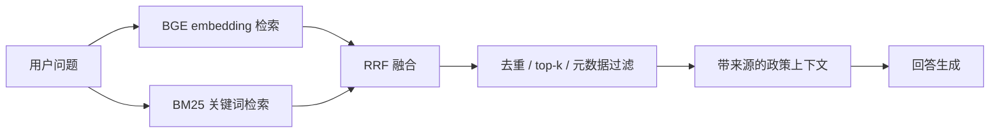

# 第 07 课：BGE + BM25 + RRF Policy RAG

## 3 分钟速记

政策检索既需要语义相似，也需要精确匹配订单状态、时限和术语。项目使用 BGE 捕捉语义、BM25 捕捉关键词，再用 Reciprocal Rank Fusion 合并名次，避免依赖两种分数的绝对尺度。

## 学习目标

- 理解稠密检索、稀疏检索和融合排序；
- 理解政策语料的来源与法律边界；
- 会运行离线检索评测并分析失败 query。

## 检索链路



RRF 常用形式：

```text
score(d) = Σ 1 / (k + rank_i(d))
```

它关注每个候选在不同检索器中的排名，而不要求 cosine score 和 BM25 score 可直接比较。

## 代码地图

- [embedding.py](../../backend/app/rag/embedding.py)：BGE embedding。
- [retrieval.py](../../backend/app/rag/retrieval.py)：BM25、dense 与 RRF。
- [ingestion.py](../../backend/app/rag/ingestion.py)：语料加载与索引。
- [evaluation.py](../../backend/app/rag/evaluation.py)：检索评测。
- [taobao_policies.json](../../backend/app/rag/corpus/taobao_policies.json)：教学政策语料。
- [evaluation_queries.json](../../backend/app/rag/corpus/evaluation_queries.json)：评测查询。

## 语料声明

当前政策语料用于模拟接近真实电商的售后规则与检索场景，不是淘宝官方实时政策，也不应以“淘宝承诺”对外发布。生产系统需要保留来源 URL、版本、生效时间和业务审核人。

## 动手实验

```bash
./scripts/download_policy_embedding_model.sh
benchmarks/.venv/bin/python scripts/evaluate_policy_rag.py
```

选择一个稠密检索失败但 BM25 命中的查询，再选择一个 BM25 失败但语义检索命中的查询，比较融合结果。

## 评测建议

- Recall@k：正确政策是否被召回；
- MRR：正确结果是否足够靠前；
- 引用准确率：回答引用是否真的支持结论；
- 无答案识别：语料没有依据时是否拒绝编造；
- 新鲜度：政策变更后索引是否按版本更新。

## 常见误区

- 把整篇政策作为一个 chunk；
- 用问题本身作为“标准答案”；
- 只测试几个成功案例；
- 检索到文本就允许模型扩写不存在的条件；
- 不保存来源和政策版本；
- embedding 模型下载失败时静默退化却不展示状态。

[上一课](06-context-memory.md) · [下一课：业务闭环与产品](08-business-product.md)

