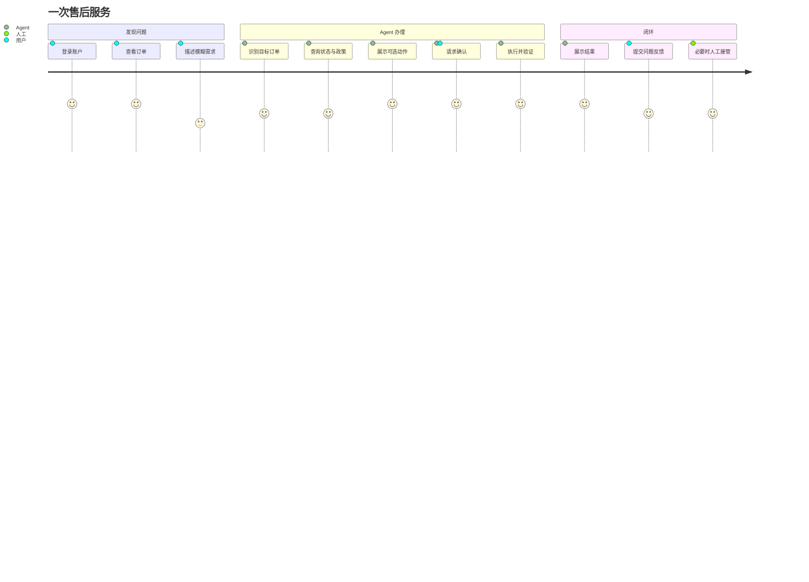

# 第 08 课：客服业务闭环与产品界面

## 3 分钟速记

一个 Agent 只有嵌入真实用户旅程，才能体现价值。订单中心负责确定性浏览，客服 Agent 负责理解模糊需求和跨步骤办理；两者不是替代关系，而是“GUI + 对话式执行”的互补。

## 学习目标

- 理解为什么产品仍需要订单、账户和帮助页面；
- 理解 Agent 的价值集中在跨页面、跨工具和模糊需求；
- 建立用户反馈与人工接管闭环。

## 用户旅程

## Agent 不应替代所有页面

- 用户知道要找什么时，订单列表比反复对话更快；
- 地址簿属于明确的账户设置，不必强制通过聊天修改；
- 政策中心适合浏览和检索，Agent 适合结合具体订单解释；
- Agent 的优势在于“帮我把刚才那个不合适的商品换成黑色”这类跨上下文任务。

## 代码地图

| 产品区域 | 后端 | 前端 |
| --- | --- | --- |
| 客服中心 | [support/service.py](../../backend/app/support/service.py) | [support/index.html](../../frontend/support/index.html) |
| 订单中心 | [orders/service.py](../../backend/app/orders/service.py) | [orders/index.html](../../frontend/orders/index.html) |
| 账户与地址 | [account/address_service.py](../../backend/app/account/address_service.py) | [account/index.html](../../frontend/account/index.html) |
| 消费分析 | [account/spending.py](../../backend/app/account/spending.py) | [spending/index.html](../../frontend/account/spending/index.html) |
| 帮助中心 | [help/service.py](../../backend/app/help/service.py) | [help/index.html](../../frontend/help/index.html) |
| 人工接管 | [support/handoff.py](../../backend/app/support/handoff.py) | [handoffs.py](../../backend/app/api/handoffs.py) |

## 动手实验：完整闭环

1. 从订单中心进入一个 pending 订单；
2. 转到客服并用自然语言要求取消；
3. 检查 Agent 没有再次要求已经明确的订单号；
4. 在确认卡片核对金额、商品与原因；
5. 确认后回到订单中心检查状态；
6. 模拟异常并提交问题反馈；
7. 在工程控制台找到反馈和关联会话。

## 产品验收维度

- 可发现：用户是否知道能做什么；
- 可理解：状态、按钮和确认文案是否清楚；
- 可恢复：失败后能否重试、修改或转人工；
- 可访问：键盘、语义标签和移动端布局是否可用；
- 一致性：订单页与 Agent 回复展示的状态是否一致；
- 即时性：发送后有进度提示，完成后流式或渐进展示结果。

## 常见误区

- 为突出 Agent 而删除所有确定性页面；
- 前端展示“执行成功”，但没有重新读取服务端状态；
- 把内部 trace、planner 名称和 policy 原文暴露给普通用户；
- 用户反馈只做“是否有帮助”，不能描述真实问题；
- 人工按钮只改变 UI，不创建可追踪的 handoff。

[上一课](07-policy-rag.md) · [下一课：评测与可观测性](09-evaluation-observability.md)

