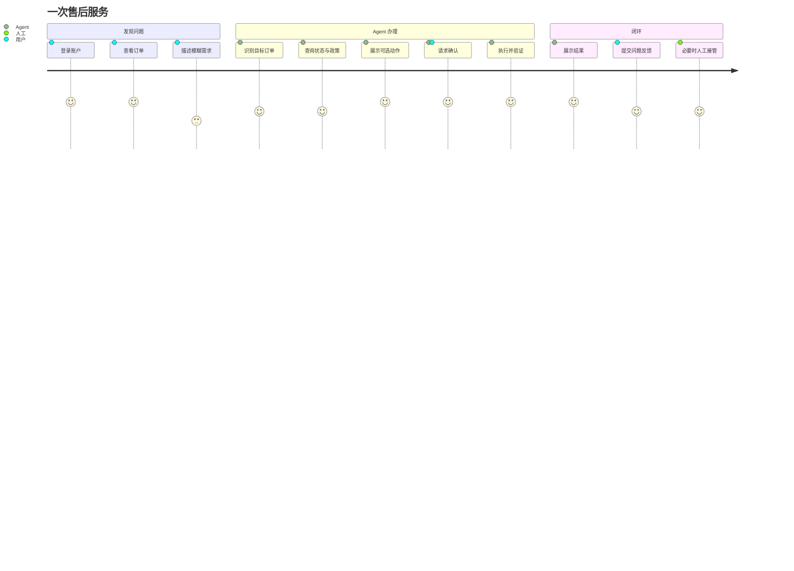
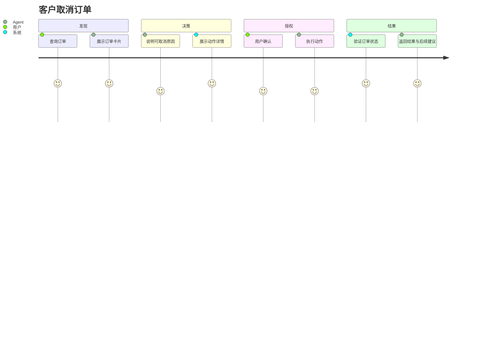

# 第 08 课：客服业务闭环与产品界面

## 3 分钟速记

一个 Agent 只有嵌入真实用户旅程，才能体现价值。订单中心负责确定性浏览，客服 Agent 负责理解模糊需求和跨步骤办理；两者不是替代关系，而是“GUI + 对话式执行”的互补。

## 学习目标

- 理解为什么产品仍需要订单、账户和帮助页面；
- 理解 Agent 的价值集中在跨页面、跨工具和模糊需求；
- 建立用户反馈与人工接管闭环。

## 用户旅程

## Agent 不应替代所有页面

- 用户知道要找什么时，订单列表比反复对话更快；
- 地址簿属于明确的账户设置，不必强制通过聊天修改；
- 政策中心适合浏览和检索，Agent 适合结合具体订单解释；
- Agent 的优势在于“帮我把刚才那个不合适的商品换成黑色”这类跨上下文任务。

## 代码地图

| 产品区域 | 后端 | 前端 |
| --- | --- | --- |
| 客服中心 | [support/service.py](../../backend/app/support/service.py) | [support/index.html](../../frontend/support/index.html) |
| 订单中心 | [orders/service.py](../../backend/app/orders/service.py) | [orders/index.html](../../frontend/orders/index.html) |
| 账户与地址 | [account/address_service.py](../../backend/app/account/address_service.py) | [account/index.html](../../frontend/account/index.html) |
| 消费分析 | [account/spending.py](../../backend/app/account/spending.py) | [spending/index.html](../../frontend/account/spending/index.html) |
| 帮助中心 | [help/service.py](../../backend/app/help/service.py) | [help/index.html](../../frontend/help/index.html) |
| 人工接管 | [support/handoff.py](../../backend/app/support/handoff.py) | [handoffs.py](../../backend/app/api/handoffs.py) |

## 动手实验：完整闭环

1. 从订单中心进入一个 pending 订单；
2. 转到客服并用自然语言要求取消；
3. 检查 Agent 没有再次要求已经明确的订单号；
4. 在确认卡片核对金额、商品与原因；
5. 确认后回到订单中心检查状态；
6. 模拟异常并提交问题反馈；
7. 在工程控制台找到反馈和关联会话。

## 产品验收维度

- 可发现：用户是否知道能做什么；
- 可理解：状态、按钮和确认文案是否清楚；
- 可恢复：失败后能否重试、修改或转人工；
- 可访问：键盘、语义标签和移动端布局是否可用；
- 一致性：订单页与 Agent 回复展示的状态是否一致；
- 即时性：发送后有进度提示，完成后流式或渐进展示结果。

## 常见误区

- 为突出 Agent 而删除所有确定性页面；
- 前端展示“执行成功”，但没有重新读取服务端状态；
- 把内部 trace、planner 名称和 policy 原文暴露给普通用户；
- 用户反馈只做“是否有帮助”，不能描述真实问题；
- 人工按钮只改变 UI，不创建可追踪的 handoff。

## 核心概念

Agent 产品不是把传统网站包进聊天框。确定性页面适合浏览、筛选、编辑和对比；对话适合表达模糊目标、跨页面协调和解释复杂规则。两者应共享业务服务与权限，而不是各自维护一套数据。

业务闭环包含四个阶段：理解目标、准备动作、授权执行、结果验真。用户体验还需要进度、可取消性、错误恢复和人工接管。任何阶段只在后端完成、前端无反馈，用户都会认为系统“没有回答”。

## 本项目中的实现

- `backend/app/support/service.py` 管理会话与消息；
- `backend/app/support/streaming.py` 输出进度、确认和回复事件；
- `backend/app/support/handoff.py` 创建人工接管记录；
- `backend/app/orders/service.py` 提供订单中心数据；
- `backend/app/account/address_service.py` 管理多地址；
- `backend/app/account/spending.py` 提供消费分析；
- `frontend/support/`、`orders/`、`account/`、`help/` 构成客户侧产品。

## 执行链路

用户在订单中心看见订单，也可以在客服中心自然语言查询。客服消息通过 streaming 先返回“正在理解/查询”等阶段，再返回订单卡片。写操作产生确认卡片而不是普通文本按钮。确认后结果通过同一会话更新，订单中心刷新时读取同一业务状态。

人工接管必须创建后端 handoff，包含会话、用户、原因和状态；只在 UI 显示“已转人工”无法追踪是否真的有人接手。

## 设计取舍

原生 HTML/CSS/JS 降低本地运行和构建成本，适合准产品与教学；复杂团队可以迁移 React/Vue，但业务 API、事件协议和权限边界应保持。流式输出采用阶段事件和文本增量结合，即使模型首 Token 慢，用户也知道系统正在查询。

地址编辑放在个人中心，而不是强迫用户与 Agent 对话。Agent 可以帮助解释或导航，但结构化表单更适合多个收货地址、电话和默认地址校验。

## 失败模式

- 发送后无任何提示：首个 streaming 事件太晚或连接失败；
- 页面显示成功但订单没变：只信最终文案，没有重新查询；
- 客服和订单中心数据不同：两套服务或缓存源不一致；
- 新建空会话不断累积：没有延迟创建或空会话清理；
- 删除/分组操作刷新后恢复：只改前端状态，未持久化；
- 人工接管无处理状态：handoff 没有生命周期。

## 动手实验：完成一个用户旅程

1. 登录演示客户；
2. 在订单中心找到 pending 订单；
3. 回客服中心用指代语句请求取消；
4. 检查进度提示、订单卡片和确认详情；
5. 先拒绝，验证订单不变；
6. 再确认，验证客服与订单中心状态一致；
7. 提交一条问题反馈，并在开发控制台找到它；
8. 发起人工服务，验证产生 handoff 记录。

## 产品验收

同时从用户、业务和工程三个视角验收：用户知道系统在做什么且能撤回；业务数据状态正确；工程人员能从 trace 解释每一步。三者缺一，闭环都不完整。

## 知识检查

为什么订单中心的存在不会削弱 Agent？因为 Agent 的价值不是替代所有 UI，而是协调复杂意图并降低跨页面操作成本；结构化页面则提供可发现性和确定性。

[上一课](07-policy-rag.md) · [下一课：评测与可观测性](09-evaluation-observability.md)

