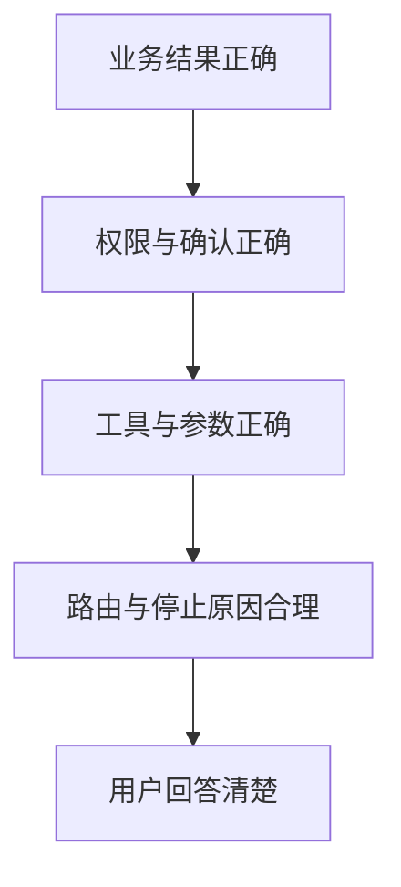
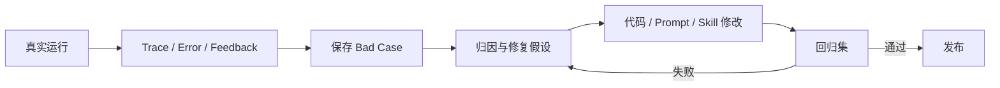

# 第 09 课：评测、Reflection、回归与可观测性

## 3 分钟速记

Agent 质量至少有三层：轨迹是否合理、策略是否安全、业务结果是否正确。Reward 只是评测器对任务完成情况的分数；它不是训练奖励，也不能替代对工具参数和数据库变化的检查。

## 学习目标

- 理解 tau2 task、expected actions、reward 和 simulation；
- 区分轨迹匹配、确认门禁和业务结果；
- 建立 bad case → 修复 → 回归的闭环；
- 正确解释 Token、成本、时延和 N/A。

## 质量金字塔



底层文本清楚不代表上层业务正确。反过来，动作序列与 benchmark 不完全一致，也不必然意味着结果失败；因此项目同时展示轨迹偏差和 outcome evidence。

## 指标解释

| 指标 | 含义 | 注意 |
| --- | --- | --- |
| Reward | evaluator 对单次 simulation 的任务分数 | 不是 RL 训练奖励 |
| 全匹配 | 实际工具轨迹与期望轨迹一致 | 过严时会惩罚等价路径 |
| 门禁成功 | 写操作按要求等待并获得确认 | 等待确认本身不是失败 |
| 落库成功 | 目标业务状态已验证变化 | 比 HTTP 成功更重要 |
| Token | 模型供应商返回的 usage | Rule 模式应显示“不适用” |
| Cost | usage × 模型价格配置 | 未知价格应显示 N/A，不伪造 0 |
| Stop reason | 为何结束循环 | 等待确认、完成、转人工、超步数等 |

## Reflection 的正确位置

Reflection 用于离线分析失败轨迹并产生改进假设，不应在写操作后让另一个模型随意修改结果。候选修复要进入回归测试，通过后才能成为新默认行为。



## 代码地图

- [runtime_task_runner.py](../../backend/app/evaluation/runtime_task_runner.py)：任务运行。
- [outcome_evaluator.py](../../backend/app/evaluation/outcome_evaluator.py)：业务结果证据。
- [runtime_regression.py](../../backend/app/evaluation/runtime_regression.py)：Runtime 回归。
- [results_compare.py](../../backend/app/evaluation/results_compare.py)：运行比较。
- [regression/service.py](../../backend/app/regression/service.py)：bad case 管理。
- [telemetry/service.py](../../backend/app/telemetry/service.py)：运行指标。
- [observability/service.py](../../backend/app/observability/service.py)：错误与反馈。

## 动手实验

1. 选择一个失败任务；
2. 找第一处偏差，而不是从最后一条错误倒推；
3. 判断是 planner routing、参数解析、Guard、MCP、结果验证还是 UI 展示问题；
4. 保存为回归案例；
5. 修复后同时验证目标案例和已有案例；
6. 比较 Token、成本和时延是否出现退化。

## 验证

```bash
./scripts/run_runtime_smoke.sh
./scripts/run_runtime_regression.sh
./scripts/check_runtime_regression.sh
```

## 常见误区

- 把等待用户确认统计为动作失败；
- Rule 模式显示 Token=0，让用户误以为调用了免费模型；
- LiteLLM 不认识价格时把成本写成 0；
- expected trajectory 来自同一个规则 Planner，造成自证正确；
- 只修当前失败任务，不跑全量回归；
- Trace 中泄露 API key、密码或客户敏感信息。

[上一课](08-business-product.md) · [下一课：生产化](10-production.md)

