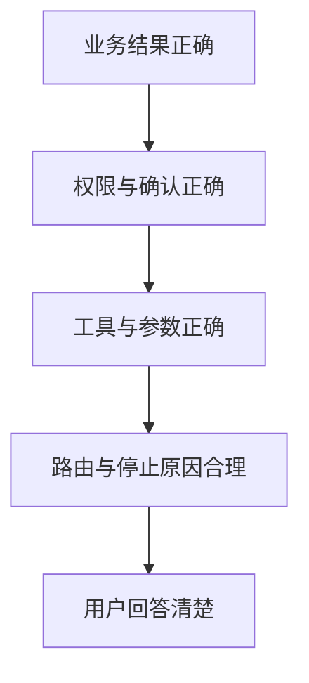
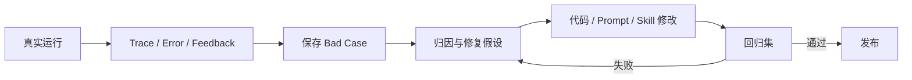
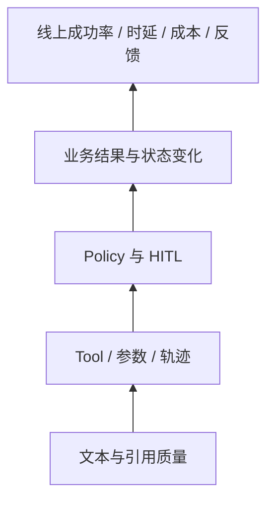

# 第 09 课：评测、Reflection、回归与可观测性

## 3 分钟速记

Agent 质量至少有三层：轨迹是否合理、策略是否安全、业务结果是否正确。Reward 只是评测器对任务完成情况的分数；它不是训练奖励，也不能替代对工具参数和数据库变化的检查。

## 学习目标

- 理解 tau2 task、expected actions、reward 和 simulation；
- 区分轨迹匹配、确认门禁和业务结果；
- 建立 bad case → 修复 → 回归的闭环；
- 正确解释 Token、成本、时延和 N/A。

## 质量金字塔



底层文本清楚不代表上层业务正确。反过来，动作序列与 benchmark 不完全一致，也不必然意味着结果失败；因此项目同时展示轨迹偏差和 outcome evidence。

## 指标解释

| 指标 | 含义 | 注意 |
| --- | --- | --- |
| Reward | evaluator 对单次 simulation 的任务分数 | 不是 RL 训练奖励 |
| 全匹配 | 实际工具轨迹与期望轨迹一致 | 过严时会惩罚等价路径 |
| 门禁成功 | 写操作按要求等待并获得确认 | 等待确认本身不是失败 |
| 落库成功 | 目标业务状态已验证变化 | 比 HTTP 成功更重要 |
| Token | 模型供应商返回的 usage | Rule 模式应显示“不适用” |
| Cost | usage × 模型价格配置 | 未知价格应显示 N/A，不伪造 0 |
| Stop reason | 为何结束循环 | 等待确认、完成、转人工、超步数等 |

## Reflection 的正确位置

Reflection 用于离线分析失败轨迹并产生改进假设，不应在写操作后让另一个模型随意修改结果。候选修复要进入回归测试，通过后才能成为新默认行为。



## 代码地图

- [runtime_task_runner.py](../../backend/app/evaluation/runtime_task_runner.py)：任务运行。
- [outcome_evaluator.py](../../backend/app/evaluation/outcome_evaluator.py)：业务结果证据。
- [runtime_regression.py](../../backend/app/evaluation/runtime_regression.py)：Runtime 回归。
- [results_compare.py](../../backend/app/evaluation/results_compare.py)：运行比较。
- [regression/service.py](../../backend/app/regression/service.py)：bad case 管理。
- [telemetry/service.py](../../backend/app/telemetry/service.py)：运行指标。
- [observability/service.py](../../backend/app/observability/service.py)：错误与反馈。

## 动手实验

1. 选择一个失败任务；
2. 找第一处偏差，而不是从最后一条错误倒推；
3. 判断是 planner routing、参数解析、Guard、MCP、结果验证还是 UI 展示问题；
4. 保存为回归案例；
5. 修复后同时验证目标案例和已有案例；
6. 比较 Token、成本和时延是否出现退化。

## 验证

```bash
./scripts/run_runtime_smoke.sh
./scripts/run_runtime_regression.sh
./scripts/check_runtime_regression.sh
```

## 常见误区

- 把等待用户确认统计为动作失败；
- Rule 模式显示 Token=0，让用户误以为调用了免费模型；
- LiteLLM 不认识价格时把成本写成 0；
- expected trajectory 来自同一个规则 Planner，造成自证正确；
- 只修当前失败任务，不跑全量回归；
- Trace 中泄露 API key、密码或客户敏感信息。

## 核心概念

Agent 评测必须分层。文本质量回答“说得怎么样”；轨迹评测回答“采取了哪些动作”；策略评测回答“是否遵守权限与确认”；业务结果回答“环境是否真的达到目标”。最终上线门禁不能只依赖其中一层。

Reward 是任务成功的数值信号，不是训练时才存在。tau2 任务通常根据目标状态和交互结果给出 reward。项目还补充 exact trajectory、business success、confirmation verified 和 state changed；需要注意，当前 `state_changed` 来自整个 Retail 数据库哈希变化，并不等价于目标字段级后置条件已经满足。



### 轨迹一致不等于结果正确

基准轨迹来自任务定义中的期望动作序列。实际工具名与参数按位置比较，可定位第一处偏差。但多条路径可能得到相同正确结果，因此 exact match 适合诊断，不应单独否决业务成功。反过来，轨迹看似正确但停在确认门禁，也不能声称已经落库。

### Reflection 的位置

Reflection 应基于失败证据产生诊断候选，例如“Skill 路由错误”“订单目标恢复失败”，再由工程人员加入回归并验证。让 Agent 在线无限反思会增加时延和不可控行为，不等于质量闭环。

## 本项目中的实现

- `backend/app/evaluation/outcome_evaluator.py` 验证目标工具、参数和状态；
- `backend/app/evaluation/results_compare.py` 比较运行结果；
- `backend/app/evaluation/runtime_regression.py` 执行回归；
- `backend/app/evaluation/runtime_quality_gate.py` 汇总门禁；
- `backend/app/regression/service.py` 管理 bad case；
- `backend/app/telemetry/service.py` 汇总调用、时延、Token 和成本；
- `backend/app/observability/redaction.py` 对观测数据脱敏。

## 执行链路

一次运行保存任务版本、Planner、模型、工具后端、Trace、usage 和业务结果。Evaluator 将实际动作与 benchmark 期望比较；确认写操作后，当前证据是执行前后数据库哈希是否变化，而不是重新断言目标订单字段。失败矩阵按 planner terminal、tool error、policy denial、action deviation、outcome failure 等分类。工程人员把真实会话加入回归集，修复后同时运行目标 case 和全量集。

成本来自 provider usage 与价格目录。Rule Planner 没有模型调用，因此 Token 为 0、目录价可能 N/A 是合理事实；LLM usage 缺失时应显示未知，而不是伪造 0。

## 设计取舍

项目保留轨迹匹配，是因为它能快速定位行为偏差；同时增加 outcome evidence，避免把多解任务误判。线上指标聚合用于趋势，单次 Trace 用于解释，两者不可互相替代。

错误收集和用户反馈分开：错误是系统检测到的异常，反馈是用户描述的问题。二者可以关联到同一会话，但处理状态和优先级不同。

## 失败模式

- 把等待确认算成失败：安全行为被错误惩罚；
- 把门禁成功算成落库成功：混淆阶段；
- LLM Token 永远为 0：usage 未透传或调用根本没发生；
- N/A 被显示为 0：未知数据被误解为免费；
- 只重跑单个 case：修复导致其他任务退化；
- 线上日志含密钥或 PII：采集前没有统一脱敏。

## 动手实验：构造一个可回归失败

在工程控制台选择一个固定 Retail 任务，用 rule 和 LLM 各运行一次。记录第一处动作偏差、停止原因、业务状态、usage 和成本。把失败加入测试，修复后再次运行，并确认历史结果仍保留。

离线验证入口：

```bash
./scripts/test_backend.sh -q backend/tests/evaluation
./scripts/test_backend.sh -q backend/tests/telemetry
```

## 指标解释清单

- 成功率必须注明分母和成功定义；
- 平均时延最好同时看 P50/P95，避免均值掩盖长尾；
- Token 区分输入、输出和缓存；
- 成本区分 provider 实际返回与目录价估算；
- 人工接管率需要结合任务复杂度，不是越低越好；
- 用户反馈率低可能是入口不可见，不必然代表满意。

## 知识检查

如果动作序列与基准不同但状态正确，应如何判定？业务成功通过、exact match 失败，并保留差异用于诊断；质量门禁如何组合两者取决于发布目标。

[上一课](08-business-product.md) · [下一课：生产化](10-production.md)

