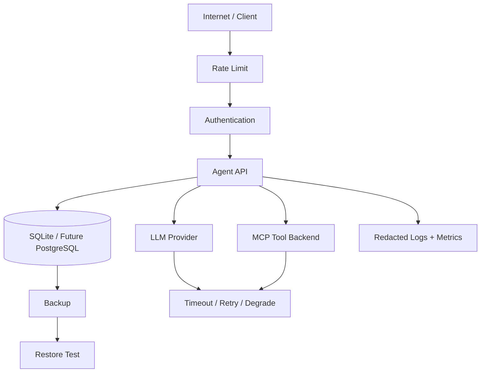

# 第 10 课：生产化、安全、备份与发布

## 3 分钟速记

“能在我的电脑运行”只证明功能链路成立。生产化还需要配置治理、认证授权、限流、健康检查、结构化日志、脱敏、备份恢复、依赖安全和可重复验收。

## 学习目标

- 识别本地准产品和多实例生产系统的差距；
- 理解 health 与 readiness 的区别；
- 掌握备份恢复、安全扫描和发布验收。

## 生产防线

```mermaid
flowchart TB
    Internet[请求] --> Headers[安全 Header / Request ID]
    Headers --> RateLimit[登录限流]
    RateLimit --> Auth[Session + Role]
    Auth --> API[业务 API]
    API --> Guard[Policy Guard]
    Guard --> MCP[MCP Tool]
    API --> Logs[JSON 日志与脱敏]
    API --> DB[(SQLite)]
    DB --> Backup[备份 + 恢复演练]
    API --> Health[/health]
    API --> Ready[/ready]
```

## 当前已实现

- 基于数据库的 customer/developer 账户和 session；
- 首次登录修改默认开发人员密码；
- 登录限流、安全响应头和 Request ID；
- JSON 日志、错误收集与敏感字段脱敏；
- `/health` 与 `/ready`；
- SQLite 备份、恢复和周期备份脚本；
- pip-audit、Bandit 和 secret scan；
- 一键生产验收脚本。

## 代码地图

- [config.py](../../backend/app/operations/config.py)：运行配置。
- [health.py](../../backend/app/operations/health.py)：健康与就绪。
- [http.py](../../backend/app/operations/http.py)：HTTP 运行防线。
- [rate_limit.py](../../backend/app/operations/rate_limit.py)：登录限流。
- [redaction.py](../../backend/app/operations/redaction.py)：敏感信息处理。
- [sqlite_backup.py](../../backend/app/operations/sqlite_backup.py)：备份恢复。
- [production-runbook.md](../operations/production-runbook.md)：运行手册。

## 发布前验收

```bash
./scripts/production_acceptance.sh
```

它应覆盖：配置检查、测试、产品栈、备份恢复、安全扫描和服务状态。验收失败应阻止发布，而不是只记录警告。

## GitHub 发布清单

- 不提交 `.env`、API key、cookie、真实客户数据；
- 不提交 SQLite/WAL/SHM、备份文件和模型缓存；
- 保留 tau2 上游许可证与 attribution；
- 轮换任何曾经暴露的密钥；
- 默认账号只用于本地演示，公开服务必须替换；
- 大型 benchmark 数据使用下载脚本、Release 或对象存储；
- README 清楚区分“当前实现”和“未来路线图”。

## 从 SQLite 演进到多实例

本地单实例继续使用 SQLite 是合理取舍。只有出现多副本并发写、独立 Worker、严格高可用或大规模分析需求时，再迁移 PostgreSQL/队列/集中式可观测平台。不要为“看起来生产化”提前引入无法运维的复杂基础设施。

## 常见误区

- `/health` 永远返回 200，即使数据库和 MCP 已失效；
- 有备份文件但从未做恢复演练；
- 日志记录完整 Prompt、密码和 API key；
- 把开发默认密码用于公网；
- 将本地模型缓存和 700MB 数据直接提交普通 Git；
- 依赖扫描有结果，但没有例外说明和处理责任人。

## 毕业项目

选择一个新的客服能力，例如“修改待处理订单中的商品规格”：

1. 定义 Skill 和 Tool schema；
2. 接入 MCP；
3. 添加身份、状态与确认策略；
4. 完成用户界面；
5. 创建成功、拒绝、越权和失败恢复测试；
6. 添加回归案例和指标；
7. 运行生产验收；
8. 在 README 中只更新已实现内容。

## 核心概念

生产化不是“把开发服务器放到云上”，而是为不可靠依赖、恶意输入、并发请求、数据损坏和人员操作建立防线。Agent 还多了模型波动、Token 成本、工具副作用和 prompt injection 等风险。

生产就绪可以分成六个面：配置与秘密、身份与授权、可靠性、可观测性、数据保护、发布与恢复。健康检查只说明进程活着；ready 检查还应确认数据库、模型配置和关键工具后端可用。



## 本项目中的实现

- `backend/app/operations/config.py` 集中读取运行配置；
- `backend/app/operations/health.py` 提供健康与就绪状态；
- `backend/app/operations/rate_limit.py` 进行请求限流；
- `backend/app/operations/redaction.py` 清理敏感字段；
- `backend/app/operations/sqlite_backup.py` 负责一致性备份；
- `backend/app/auth/` 管理密码、会话和角色；
- `scripts/production_acceptance.sh` 执行生产验收；
- Dockerfile 与 Compose 提供可重复启动方式。

## 执行链路

启动时配置层验证必要变量，不从代码读取真实密钥。应用建立数据库并执行迁移，ready 检查确认依赖。请求经过限流与认证后进入 API。模型和 MCP 调用设置超时，失败转化为可观测错误或安全降级。日志在写出前脱敏。定时备份只有在恢复演练通过后才算有效。

## 设计取舍

当前采用 SQLite 单实例，适合本地完整演示和小规模部署：事务简单、零外部数据库依赖。它不适合多个应用实例共享写入，也不能替代高可用数据库。向 PostgreSQL 演进时需要迁移 repository、连接管理、锁与备份方案。

Docker 是可选交付方式，不是开发强制依赖。保留本地 Conda 路径让学习者更容易调试，容器则提供一致部署环境。两条路径必须读取同一配置契约。

## 失败模式

- `.env` 或 API key 提交 GitHub：立即轮换，删除并清理历史；
- `/health` 正常但模型/数据库不可用：缺少 readiness；
- 自动重试写操作：可能造成重复取消或退款；
- 日志记录 Authorization、密码或完整地址：脱敏边界错误；
- 有备份从未恢复：无法证明备份可用；
- 依赖漏洞只用永久 ignore：豁免没有负责人和到期日；
- 默认管理员密码未修改：演示配置进入真实部署。

## 动手实验：生产验收与故障演练

```bash
./scripts/production_acceptance.sh
./scripts/security_scan.sh
```

然后完成三类演练：停止 MCP 服务，确认只读请求得到明确错误而不是假结果；配置无效模型，确认 ready 或控制台显示异常；创建数据库备份并恢复到临时路径，验证账户和订单引用一致。

## 从单实例到多实例

演进顺序应由风险驱动：先把 SQLite repository 替换为 PostgreSQL，再把进程内限流和会话状态迁移到共享存储；引入队列处理长任务；接入集中日志、指标和 Trace；最后才考虑 Kubernetes 自动扩缩容。过早引入基础设施会掩盖 Agent 本身的质量问题。

多实例还需要处理确认 action 的原子消费、分布式幂等键、后台任务可见性、数据库迁移锁和版本兼容。仅把容器副本数改为 3 并不等于系统已经水平扩展。

## 发布检查

发布前确认：测试与质量门禁通过；默认账号处理；密钥不在仓库；第三方许可证保留；模型与政策版本可追溯；备份和恢复成功；错误与成本告警可见；回滚步骤明确。

## 知识检查

为什么模型服务不可用时不能自动退回 Rule 并假装正常？降级会改变能力和回答质量，必须显式标记、限制可执行动作并让观测系统知道当前运行模式。

[上一课](09-evaluation-observability.md) · [返回课程主页](README.md) · [返回项目首页](../../README.md)

