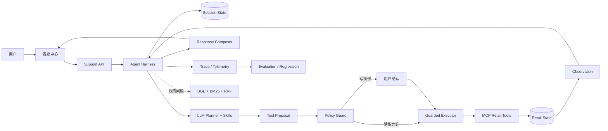
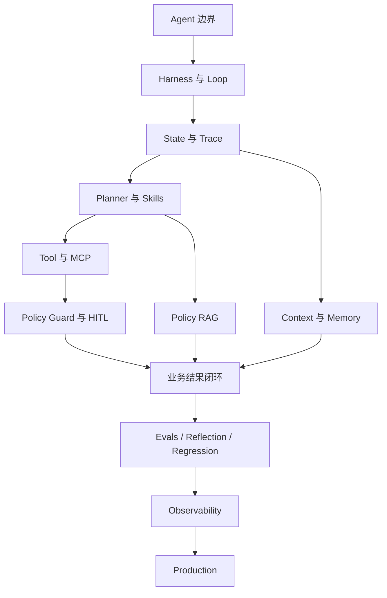

# 从 Demo 到准产品：电商客服 Agent 工程实战

这不是一组“调用一次模型 API”的示例，而是一套围绕真实业务 Agent 展开的工程课程。我们会从一次用户提问出发，依次拆开模型决策、状态循环、工具协议、权限门禁、上下文记忆、知识检索、业务验真、质量评测和生产运行。

课程对应的完整项目是 **Adaptive E-commerce Agent**。你可以一边阅读原理，一边在本地客服中心、工程控制台和源码中看到它们真实运行。

> 学习目标不是记住一个框架的 API，而是获得一套可以迁移到金融助手、企业知识助手、运维 Agent 等场景的工程方法。

## 适合谁

- 会使用 Python，了解 HTTP、JSON 和基本数据库概念；
- 调用过 LLM，但不清楚 Agent 与聊天机器人的本质差异；
- 听过 ReAct、MCP、RAG、Memory、HITL，却不知道它们如何组合；
- 已经做出 Agent Demo，希望继续解决安全、评测、观测和上线问题；
- 希望阅读一个没有隐藏关键步骤的端到端业务项目。

## 学完能获得什么

完成十课后，你应该能独立回答以下问题：

1. 为什么“模型会调用函数”还不等于业务 Agent？
2. Harness 如何把不确定的模型输出变成受控的状态循环？
3. Planner、Skill、Tool、MCP 和业务服务分别承担什么职责？
4. 为什么权限检查不能只写在 prompt 里？
5. 多轮上下文、业务状态和长期记忆有什么区别？
6. BGE、BM25 与 RRF 如何组成可降级的混合检索？
7. 为什么轨迹完全匹配并不必然代表业务成功？
8. 如何让高风险动作经过可验证的人机确认？
9. 如何收集 Token、成本、时延、错误和用户反馈形成质量闭环？
10. 一个本地准产品距离多实例生产系统还差哪些工程能力？

## Agent 系统全景



这张图包含三条同时运行的链：

- **认知链**：用户意图 → Planner → 结构化提案；
- **执行链**：提案 → Guard → HITL → MCP → 业务状态；
- **质量链**：事件轨迹 → 指标 → 评测 → 回归 → 下一次改进。

只实现认知链，会得到一个能说但不可靠的 Demo；只实现执行链，会退化成传统工作流；没有质量链，系统每次改 prompt 都像盲飞。

## 核心知识图谱



学习顺序不能随意打乱：不知道状态和循环，就很难正确理解 Memory；不知道提案与执行分离，就会把权限寄托给模型；不知道业务结果验真，就容易把“回复得像”当作“任务完成”。

## 贯穿十课的案例

客户登录后说：

> “查一下我的待处理订单。把刚才那个办公椅订单取消掉。”

系统需要完成：

1. 登录态把当前会话绑定到唯一客户，不能访问其他用户；
2. 第一轮查询订单，并把订单 ID、状态等观察写入会话状态；
3. 第二轮从“刚才那个办公椅订单”恢复目标订单；
4. Planner 生成 `cancel_pending_order` 的结构化工具提案；
5. Guard 识别这是数据库写操作，不能直接执行；
6. 前端展示动作详情，要求用户明确确认；
7. 用户提交服务端 `action_id`；当前 Guard 用工具名与参数 fingerprint 匹配原提案；
8. MCP 工具执行取消操作；
9. 当前 Executor 通过 Retail 数据库哈希确认发生状态变化；目标字段级后置条件验证仍是演进项；
10. Trace 保存决策、门禁、执行和回复事件；
11. Telemetry 记录时延、Token、成本和停止原因；
12. 如果失败，工程人员把该会话加入回归集。

十课会从不同角度观察这条链，但不会重复相同内容：每课只深入一个工程问题。

## 十课地图

| 课次 | 核心问题 | 关键产出 | 项目落点 |
| --- | --- | --- | --- |
| [01](01-from-chatbot-to-agent.md) | Agent 与聊天机器人差在哪里？ | 业务闭环和职责边界 | `agent/session_service.py` |
| [02](02-harness-state-loop.md) | 谁驱动模型反复思考与行动？ | Harness、状态机、停止条件 | `agent/runtime.py`、`state.py` |
| [03](03-planner-skills.md) | 模型怎样提出可执行动作？ | Planner、Skill、Tool Proposal | `proposal_generator.py`、`skills.py` |
| [04](04-mcp-tools.md) | 工具如何标准化并隔离业务后端？ | Port/Adapter 与 MCP | `tools/`、`mcp/retail_server.py` |
| [05](05-policy-hitl.md) | 谁决定动作是否允许执行？ | Policy Guard 与 HITL | `policy/guard.py`、`guarded_executor.py` |
| [06](06-context-memory.md) | Agent 如何记住“刚才那个订单”？ | Context、Memory、身份边界 | `session_store.py`、`proposal_generator.py` |
| [07](07-policy-rag.md) | Agent 如何依据政策回答？ | BGE + BM25 + RRF | `rag/`、`help/service.py` |
| [08](08-business-product.md) | 如何形成用户可用的业务闭环？ | 流式 UI、验真、人工接管 | `support/`、`orders/`、`frontend/` |
| [09](09-evaluation-observability.md) | 如何知道 Agent 真的变好了？ | 结果评测、回归和观测 | `evaluation/`、`telemetry/` |
| [10](10-production.md) | 如何安全、稳定地运行？ | 配置、安全、备份与演进 | `operations/`、`scripts/` |

## 三条推荐路线

### 路线 A：完整工程路线

按 01 → 10 顺序学习。适合第一次系统构建 Agent 的读者。每课完成实验后再进入下一课，约需要 12–20 小时。

### 路线 B：已有 Demo 的补强路线

先读 01、05、09、10，再回到 02、03、04。它优先解决权限、评测和上线风险，适合已经能调用工具但系统不稳定的项目。

### 路线 C：RAG/知识助手路线

先读 01、02、06、07、09。重点关注状态、引用、检索质量和评测；完成后再补 MCP 与 HITL。

## 每课怎么读

每一课都有两条并行叙事：

- **通用知识**解释该概念在 Agent 系统中的位置，可以迁移到其他项目；
- **本项目实现**指向真实代码、事件和页面，帮助你验证理解。

建议采用以下循环：

1. 先读“本课解决什么问题”和“核心概念”；
2. 不看代码，尝试画出你理解的执行链路；
3. 对照 Mermaid 图和项目实现修正；
4. 打开关键文件，只追踪一个案例，不要一开始逐行阅读；
5. 运行实验，观察 Trace 和业务状态；
6. 回答知识检查，确认你能解释“为什么”，而不只是“在哪里”。

## 统一术语

| 术语 | 本课程中的含义 |
| --- | --- |
| Agent | 能基于状态选择动作、观察环境并持续推进目标的系统 |
| Harness | 承载模型、状态、工具、策略和循环的确定性运行时 |
| Planner | 根据当前状态提出下一步动作或回复的决策组件 |
| Skill | 面向某类任务的受控知识、工具范围和规划提示 |
| Tool Proposal | Planner 输出的结构化动作建议，尚未获得执行权 |
| Tool | 对环境产生读取或写入作用的可调用能力 |
| MCP | 用统一协议描述、发现和调用工具的边界 |
| Observation | 工具执行后返回给 Agent 的环境证据 |
| Policy Guard | 用确定性规则判定动作允许、拒绝或需要确认 |
| HITL | 人在关键节点审阅、确认、拒绝或接管 |
| Context | 当前推理所能看到的信息集合 |
| Memory | 跨步骤或跨请求保留并可恢复的信息机制 |
| RAG | 检索外部知识并把证据提供给生成模型 |
| Trace | 一次运行中按顺序记录的用户、模型、门禁和工具事件 |
| Eval | 用固定任务和指标判断系统能力与退化 |
| Reflection | 基于失败证据形成诊断或改进候选，而不是无限自我思考 |

## 实验环境

课程默认从项目根目录运行命令，并使用已有 Conda/虚拟环境。常用入口：

```bash
./scripts/run_local_product.sh
./scripts/test_backend.sh -q
BASE_URL=http://127.0.0.1:8020 ./scripts/validate_product_stack.sh
```

涉及真实 LLM 的实验会明确标记为“可选”，因为它依赖 API key、模型可用性和额度；核心结构实验应能通过 rule、fixture 或测试离线完成。

## 完成标准

读完不等于学会。你至少应完成以下成果：

- 能从客服请求画出 Planner → Guard → MCP → Observation 的时序图；
- 能解释当前工具名+参数 fingerprint 的作用及其尚未覆盖的用户、会话、过期与资源版本边界；
- 能定位一个会话的状态、Trace、业务结果和遥测指标；
- 能构造一个失败任务并加入回归；
- 能解释 BGE、BM25 与 RRF 各自解决的问题；
- 能指出本项目从 SQLite 单实例演进到多实例时必须替换的组件；
- 能为另一个业务域设计 Tool Port、Policy Guard 和 Eval 契约。

## 阅读约定

- 路径均相对于仓库根目录；
- `event.name` 表示 Trace 中的事件类型；
- “允许执行”不等于“业务成功”，结果必须通过环境状态验证；
- 页面截图可能随 UI 更新变化，代码接口和验证命令是主要依据；
- 课程中的零售数据是合成演示数据，不是真实客户数据；
- 演示政策用于教学，不代表淘宝或任何平台的正式规则。

## 从这里开始

进入 [第 01 课：从聊天机器人到业务 Agent](01-from-chatbot-to-agent.md)。

如果你想先了解资料来源和延伸阅读，请查看 [课程参考资料](references.md)。
