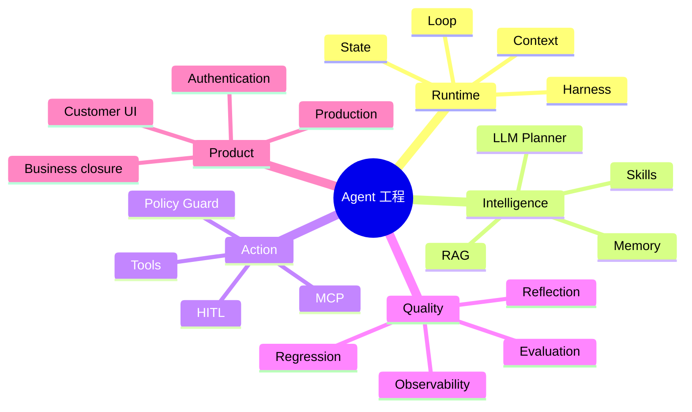

# 从 Demo 到准产品：电商客服 Agent 工程实战

这不是一套脱离代码的概念课。你会沿着当前仓库的真实执行链路，理解并验证一个业务 Agent 如何从用户消息走到 Planner、MCP 工具、确定性审批、数据库结果、评测和生产运维。

## 适合谁

- 已会 Python，希望系统学习 Agent 应用工程的开发者；
- 做过 RAG 或 Tool Calling Demo，但不清楚如何接入真实业务的人；
- 希望准备 Agent、LLM 应用、AI 全栈或智能客服项目作品集的人。

## 学完能获得什么

这些主题也对应当前 Agent 应用岗位常见的工程要求：Workflow/Loop、Tool Calling、MCP、RAG、Memory、多轮上下文、审批、调试诊断、评测与上线。

## 建议学习方式

1. 先按根 [README](../../README.md#快速开始) 启动产品，完整使用一次客服中心。
2. 每课先看“3 分钟速记”，再按代码地图阅读真实实现。
3. 完成课后实验并执行验证命令。
4. 把发现的 bad case 加到回归集，而不是只修改 Prompt 后凭感觉判断。

## 课程地图

| 课次 | 主题 | 核心问题 | 实践结果 |
| --- | --- | --- | --- |
| 01 | [从聊天机器人到业务 Agent](01-from-chatbot-to-agent.md) | Agent 比普通聊天多了什么？ | 读懂完整业务闭环 |
| 02 | [Harness、状态与 Agent Loop](02-harness-state-loop.md) | 谁控制模型、工具和停止条件？ | 跟踪一次 turn |
| 03 | [LLM Planner、Skills 与结构化提案](03-planner-skills.md) | 如何让模型决策但不直接掌权？ | 检查 Tool Proposal |
| 04 | [MCP 工具层与 Retail 业务](04-mcp-tools.md) | 工具为何要从 Agent 中解耦？ | 查看并调用工具目录 |
| 05 | [Policy Guard、权限与 HITL](05-policy-hitl.md) | 如何避免 Agent 误操作？ | 验证 action fingerprint |
| 06 | [Context、Memory 与身份边界](06-context-memory.md) | “取消它”如何理解且不越权？ | 验证跨轮上下文 |
| 07 | [BGE + BM25 + RRF Policy RAG](07-policy-rag.md) | 政策回答如何可检索、可追溯？ | 运行 RAG 评测 |
| 08 | [客服业务闭环与产品界面](08-business-product.md) | 如何从工具 Demo 变成用户产品？ | 完成订单售后流程 |
| 09 | [评测、Reflection、回归与可观测性](09-evaluation-observability.md) | 如何证明 Agent 真的变好了？ | 分析一条失败轨迹 |
| 10 | [生产化、安全、备份与发布](10-production.md) | 本地 Demo 距离上线还差什么？ | 完成生产验收 |

## 推荐路线

- **2 小时导览**：01 → 02 → 04 → 05 → 09
- **Agent 开发路线**：01 → 02 → 03 → 04 → 05 → 06 → 09
- **RAG 专项路线**：01 → 07 → 09
- **全栈作品集路线**：按 01～10 顺序完成

## 贯穿课程的案例

> 用户已经登录并绑定 Retail 身份，先问“订单 #W8770097 能退货吗？”，随后说“那就取消订单”。系统必须复用上轮订单上下文，识别订单仍为 pending，准备取消动作，展示详情等待确认，确认后调用 MCP，并重新读取订单状态验证取消成功。

这个案例同时检验：上下文、Tool selection、政策、权限、HITL、业务结果和可观测性。

## 阅读约定

- “模型决策”不等于“模型直接执行”。
- “调用成功”不等于“业务成功”。
- “保存聊天记录”不等于“拥有有效 Memory”。
- “能检索文本”不等于“回答有可靠依据”。
- “一次演示成功”不等于“可回归、可上线”。

[课程设计参考](references.md) · [返回项目首页](../../README.md)

